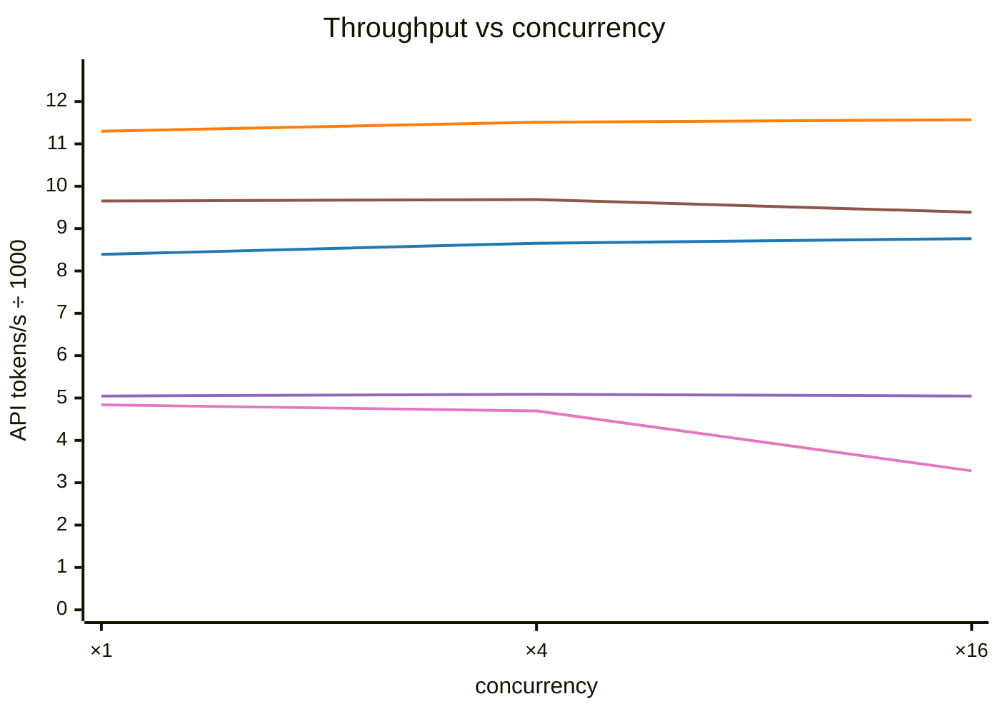
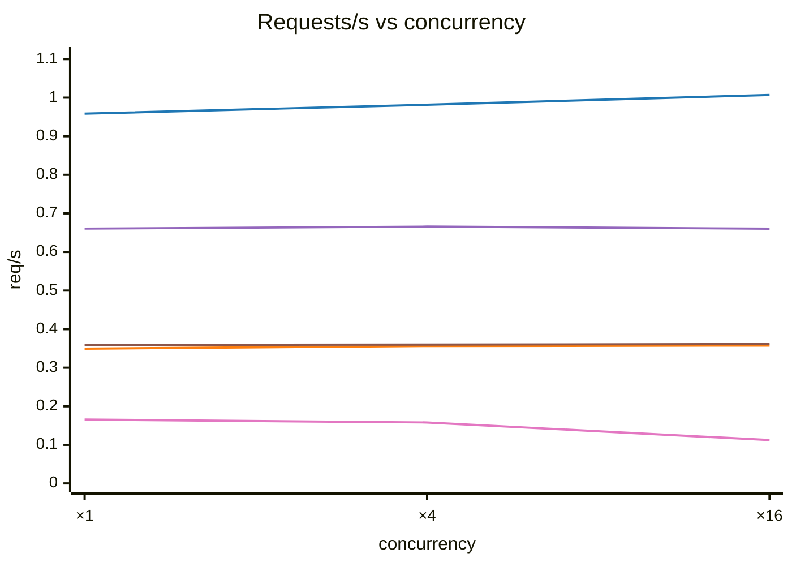
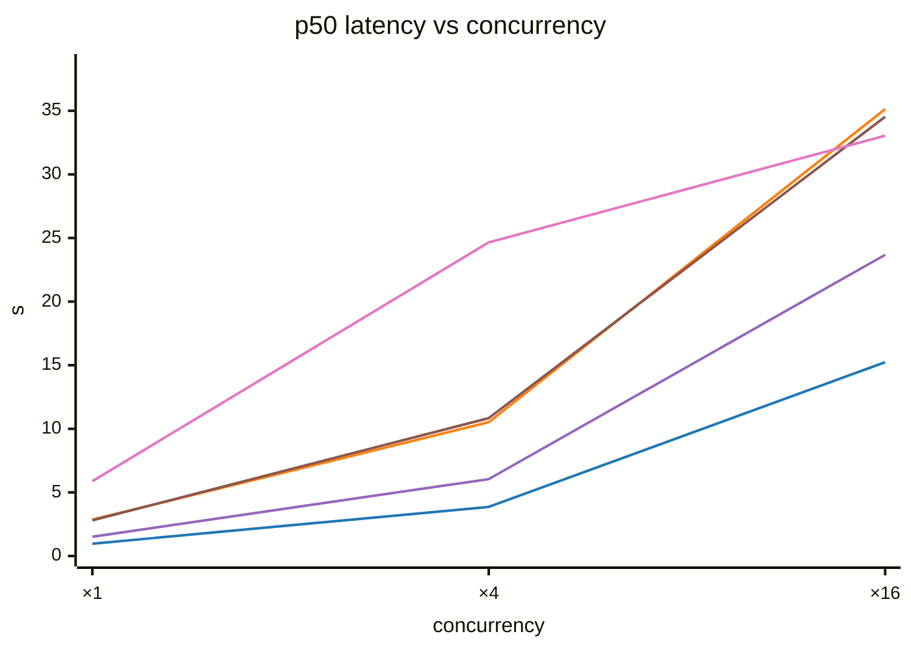

## speed — 2026-11-22 23:15 UTC

**PASS** · 643 s · 284 requests · 10 (3.5%) errors · 0 rate-limited · 4,650,548 tokens billed

Closed loop, 25 s per cell, 5 request classes × concurrency [1, 4, 16]. 284 requests, 4,650,548 tokens billed.

|  | requests | errors | 429s | p50 s | p90 s | p99 s | max s | req/s | API tok/s | MRR |
|---|---|---|---|---|---|---|---|---|---|---|
| short20 ×1 | 24 | 0 (0.0%) | 0 | 0.966 | 1.362 | 1.853 | 1.892 | 0.959 | 8,390 | 0.684 |
| short20 ×4 | 27 | 0 (0.0%) | 0 | 3.863 | 5.078 | 5.511 | 5.513 | 0.982 | 8,654 | 0.707 |
| short20 ×16 | 41 | 0 (0.0%) | 0 | 15.2 | 16.2 | 17.0 | 17.3 | 1.007 | 8,764 | 0.748 |
| many100 ×1 | 9 | 0 (0.0%) | 0 | 2.857 | 2.923 | 2.954 | 2.958 | 0.349 | 11,304 | 1.000 |
| many100 ×4 | 12 | 0 (0.0%) | 0 | 10.5 | 11.3 | 11.8 | 11.9 | 0.356 | 11,509 | 1.000 |
| many100 ×16 | 24 | 0 (0.0%) | 0 | 35.1 | 44.7 | 44.9 | 45.0 | 0.358 | 11,574 | 1.000 |
| long8k ×1 | 17 | 0 (0.0%) | 0 | 1.517 | 1.527 | 1.537 | 1.537 | 0.661 | 5,047 | 1.000 |
| long8k ×4 | 20 | 0 (0.0%) | 0 | 6.048 | 6.129 | 6.137 | 6.139 | 0.666 | 5,087 | 1.000 |
| long8k ×16 | 32 | 0 (0.0%) | 0 | 23.7 | 24.5 | 24.5 | 24.5 | 0.660 | 5,046 | 1.000 |
| pack32k ×1 | 10 | 0 (0.0%) | 0 | 2.807 | 2.975 | 3.297 | 3.332 | 0.359 | 9,651 | 1.000 |
| pack32k ×4 | 12 | 0 (0.0%) | 0 | 10.8 | 11.5 | 11.9 | 12.0 | 0.360 | 9,686 | 1.000 |
| pack32k ×16 | 24 | 0 (0.0%) | 0 | 34.5 | 44.4 | 44.6 | 44.6 | 0.361 | 9,387 | 1.000 |
| long32k ×1 | 5 | 0 (0.0%) | 0 | 5.881 | 6.428 | 6.552 | 6.566 | 0.166 | 4,839 | 1.000 |
| long32k ×4 | 8 | 0 (0.0%) | 0 | 24.7 | 25.9 | 26.4 | 26.4 | 0.158 | 4,697 | 1.000 |
| long32k ×16 | 19 | 10 (52.6%) | 0 | 33.0 | 53.2 | 57.3 | 57.8 | 0.112 | 3,282 | 1.000 |

| error | count | example | response |
|---|---|---|---|
| http 424 ModelError timed out at SageMaker | 10 | natural-qmsum natural-qmsum/query_38 | {"ErrorCode":"INTERNAL_FAILURE_FROM_MODEL","LogStreamArn":"arn:aws:logs:eu-west-3:<account-id>:log-group:/aws/sagemaker/Endpoints/reranker-tl-8b-q2","Message":"Received server error (0) from primary with message \"Your invocation timed out while waiting for a response from container primary. Review |

*Throughput vs concurrency: short20, many100, long8k, pack32k, long32k*

*Requests/s vs concurrency: short20, many100, long8k, pack32k, long32k*

*p50 latency vs concurrency: short20, many100, long8k, pack32k, long32k*
