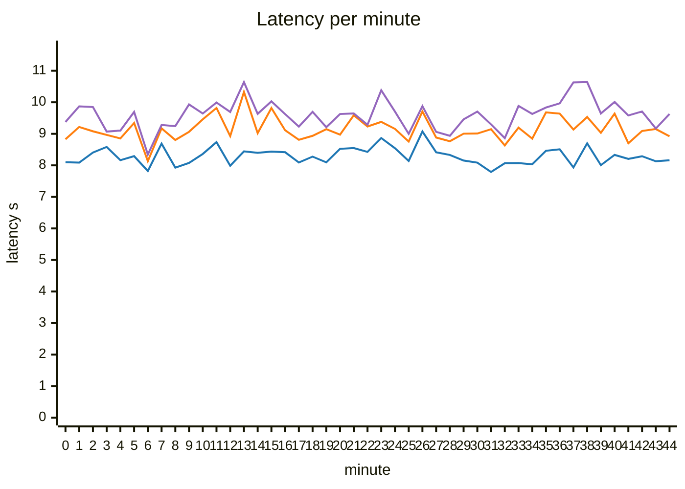
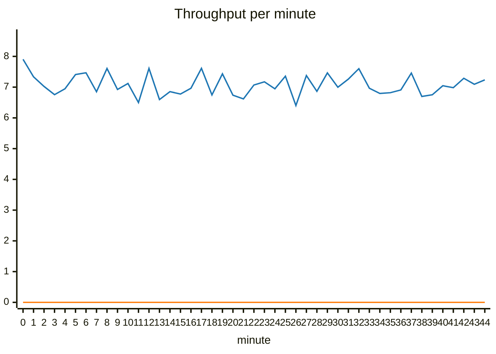

## hammer32k — 2026-11-22 22:24 UTC

**PASS** · 2707 s · 646 requests · 0 (0.0%) errors · 0 rate-limited · 19,100,052 tokens billed

45 min closed loop with 2 concurrent ~32K-token requests (350 distinct). 646 requests, 19,100,052 tokens billed.

|  | requests | errors | 429s | p50 s | p90 s | p99 s | max s | req/s | API tok/s | MRR |
|---|---|---|---|---|---|---|---|---|---|---|
| all | 646 | 0 (0.0%) | 0 | 8.230 | 9.231 | 10.0 | 10.6 | 0.239 | 7,074 | 0.997 |
| min 0–5 | 73 | 0 (0.0%) | 0 | 8.239 | 9.077 | 9.855 | 9.872 | 0.243 | 7,194 | 1.000 |
| min 5–10 | 73 | 0 (0.0%) | 0 | 8.052 | 9.074 | 9.761 | 9.931 | 0.243 | 7,251 | 1.000 |
| min 10–15 | 71 | 0 (0.0%) | 0 | 8.285 | 9.643 | 10.6 | 10.6 | 0.237 | 6,935 | 0.993 |
| min 15–20 | 72 | 0 (0.0%) | 0 | 8.155 | 9.168 | 9.931 | 10.0 | 0.240 | 7,106 | 0.993 |
| min 20–25 | 70 | 0 (0.0%) | 0 | 8.566 | 9.300 | 9.916 | 10.4 | 0.233 | 6,909 | 1.000 |
| min 25–30 | 72 | 0 (0.0%) | 0 | 8.270 | 9.077 | 9.841 | 9.876 | 0.240 | 7,092 | 1.000 |
| min 30–35 | 72 | 0 (0.0%) | 0 | 8.068 | 9.074 | 9.758 | 9.884 | 0.240 | 7,124 | 1.000 |
| min 35–40 | 71 | 0 (0.0%) | 0 | 8.307 | 9.634 | 10.6 | 10.6 | 0.237 | 6,927 | 0.991 |
| min 40–45 | 72 | 0 (0.0%) | 0 | 8.168 | 9.165 | 9.900 | 10.0 | 0.240 | 7,129 | 0.993 |

*Latency per minute: p50, p90, max*

*Throughput per minute: API tokens/s ÷ 1000, errors*
