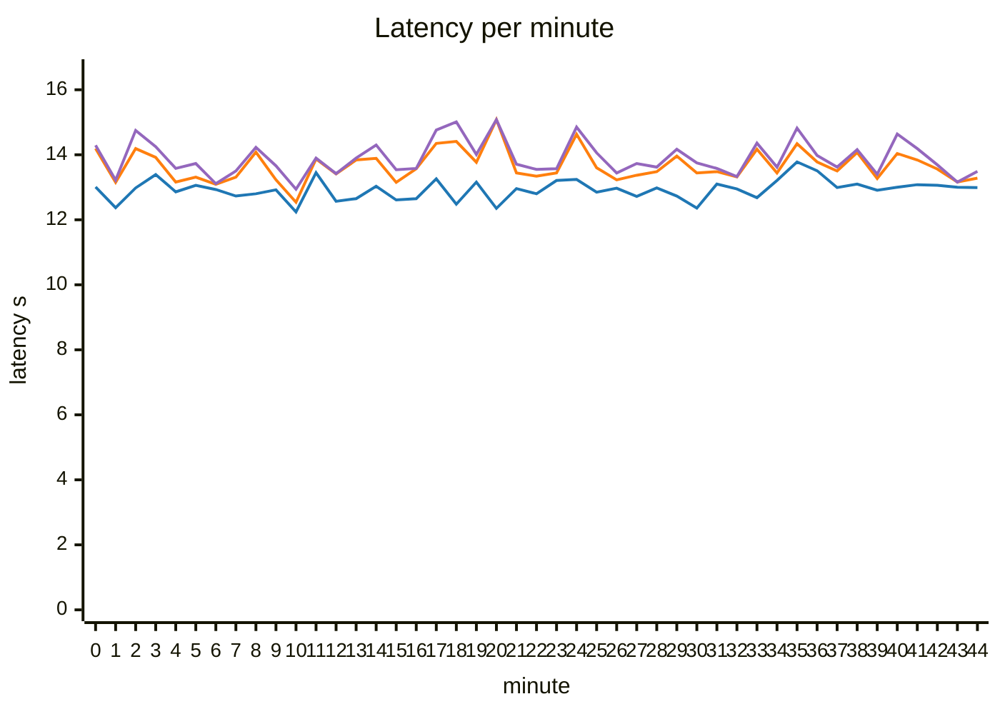
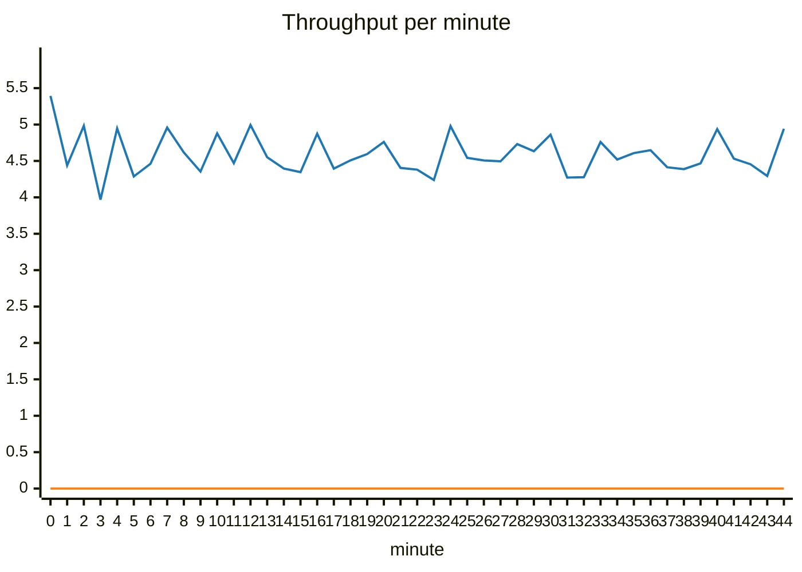

## hammer32k — 2026-11-22 23:10 UTC

**PASS** · 2713 s · 419 requests · 0 (0.0%) errors · 0 rate-limited · 12,387,093 tokens billed

45 min closed loop with 2 concurrent ~32K-token requests (350 distinct). 419 requests, 12,387,093 tokens billed.

|  | requests | errors | 429s | p50 s | p90 s | p99 s | max s | req/s | API tok/s | MRR |
|---|---|---|---|---|---|---|---|---|---|---|
| all | 419 | 0 (0.0%) | 0 | 12.9 | 13.7 | 14.8 | 15.1 | 0.155 | 4,588 | 0.995 |
| min 0–5 | 48 | 0 (0.0%) | 0 | 13.0 | 13.9 | 14.5 | 14.8 | 0.160 | 4,746 | 0.990 |
| min 5–10 | 46 | 0 (0.0%) | 0 | 12.9 | 13.5 | 14.1 | 14.2 | 0.153 | 4,535 | 1.000 |
| min 10–15 | 47 | 0 (0.0%) | 0 | 12.8 | 13.8 | 14.1 | 14.3 | 0.157 | 4,658 | 0.989 |
| min 15–20 | 46 | 0 (0.0%) | 0 | 12.9 | 13.9 | 14.9 | 15.0 | 0.153 | 4,543 | 1.000 |
| min 20–25 | 47 | 0 (0.0%) | 0 | 13.0 | 13.6 | 15.1 | 15.1 | 0.157 | 4,552 | 0.989 |
| min 25–30 | 46 | 0 (0.0%) | 0 | 12.9 | 13.6 | 14.1 | 14.2 | 0.153 | 4,582 | 1.000 |
| min 30–35 | 47 | 0 (0.0%) | 0 | 12.8 | 13.6 | 14.3 | 14.4 | 0.157 | 4,538 | 1.000 |
| min 35–40 | 45 | 0 (0.0%) | 0 | 13.2 | 14.1 | 14.6 | 14.8 | 0.150 | 4,505 | 1.000 |
| min 40–45 | 47 | 0 (0.0%) | 0 | 13.0 | 13.6 | 14.4 | 14.6 | 0.157 | 4,631 | 0.989 |

*Latency per minute: p50, p90, max*

*Throughput per minute: API tokens/s ÷ 1000, errors*
