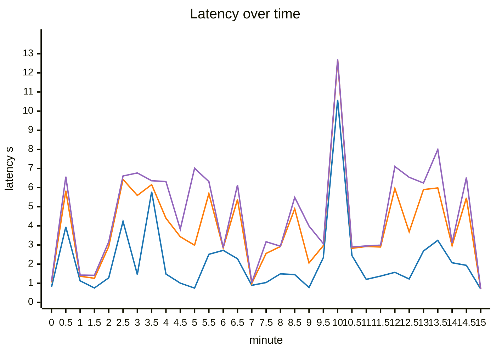
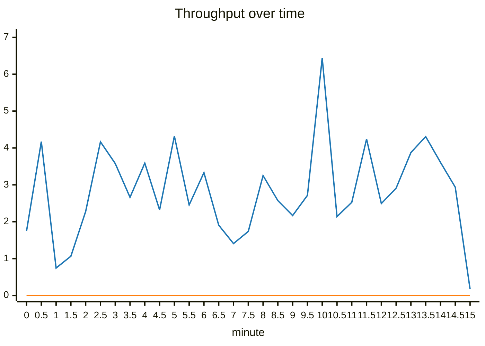

## normal — 2026-11-22 22:54 UTC

**PASS** · 918 s · 216 requests · 0 (0.0%) errors · 0 rate-limited · 2,635,614 tokens billed

15 min of Poisson traffic at 0.25 req/s; mix short20 60%, many100 10%, mid1k 10%, mid4k 10%, long8k 5%, long32k 5%. Billed 2,635,614 tokens.

|  | requests | errors | 429s | p50 s | p90 s | p99 s | max s | req/s | API tok/s | MRR |
|---|---|---|---|---|---|---|---|---|---|---|
| all | 216 | 0 (0.0%) | 0 | 1.487 | 6.191 | 12.6 | 12.7 | 0.240 | 2,928 | 0.838 |
| short20 | 119 | 0 (0.0%) | 0 | 1.022 | 5.185 | 9.971 | 12.7 | 0.132 | 1,159 | 0.714 |
| many100 | 26 | 0 (0.0%) | 0 | 2.949 | 5.243 | 12.3 | 12.7 | 0.029 | 936 | 0.962 |
| mid1k | 16 | 0 (0.0%) | 0 | 0.175 | 2.571 | 5.326 | 5.782 | 0.018 | 17.8 | 1.000 |
| mid4k | 22 | 0 (0.0%) | 0 | 0.711 | 5.027 | 10.9 | 12.3 | 0.024 | 93.0 | 1.000 |
| long8k | 15 | 0 (0.0%) | 0 | 1.519 | 5.396 | 11.7 | 12.7 | 0.017 | 127 | 1.000 |
| long32k | 18 | 0 (0.0%) | 0 | 6.309 | 6.842 | 11.3 | 12.2 | 0.020 | 595 | 1.000 |

*Latency over time: p50, p90, max*

*Throughput over time: API tokens/s ÷ 1000, errors*
