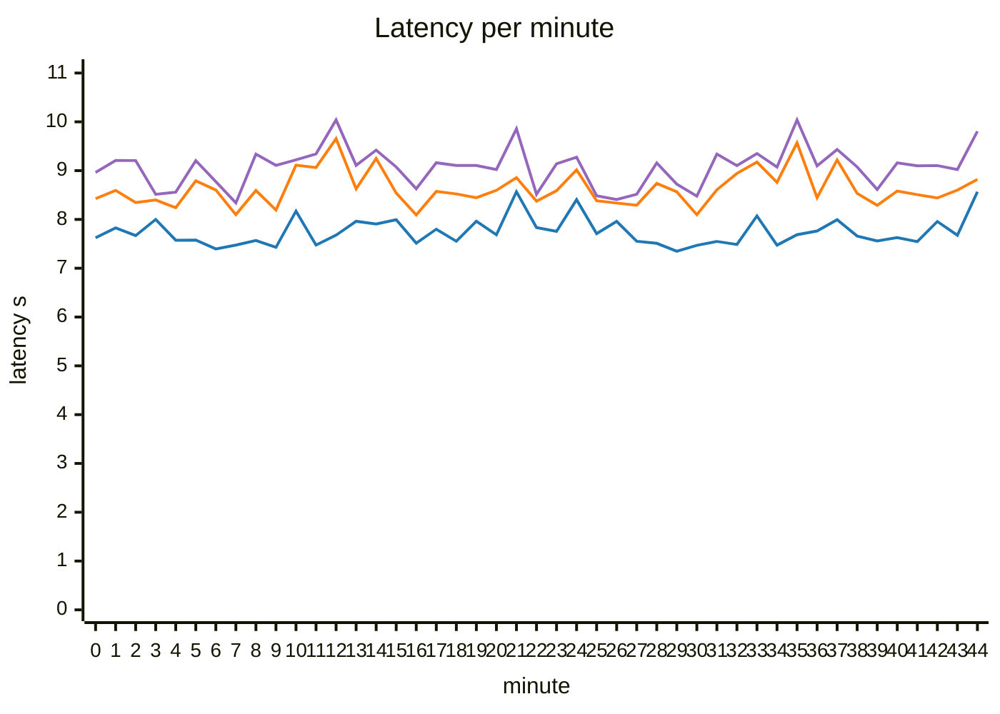
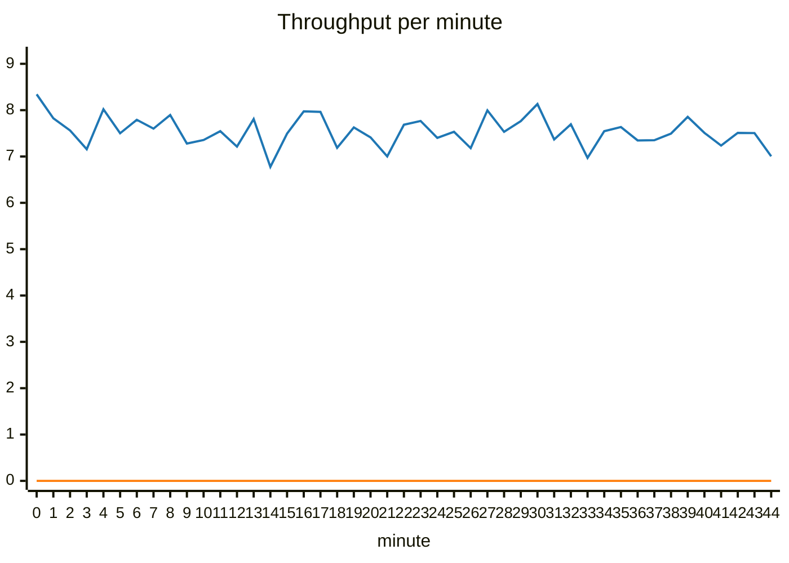

## hammer32k — 2026-11-22 23:30 UTC

**PASS** · 2705 s · 689 requests · 0 (0.0%) errors · 0 rate-limited · 20,361,180 tokens billed

45 min closed loop with 2 concurrent ~32K-token requests (350 distinct). 689 requests, 20,361,180 tokens billed.

|  | requests | errors | 429s | p50 s | p90 s | p99 s | max s | req/s | API tok/s | MRR |
|---|---|---|---|---|---|---|---|---|---|---|
| all | 689 | 0 (0.0%) | 0 | 7.708 | 8.663 | 9.422 | 10.0 | 0.255 | 7,541 | 0.998 |
| min 0–5 | 79 | 0 (0.0%) | 0 | 7.688 | 8.484 | 9.207 | 9.209 | 0.263 | 7,782 | 1.000 |
| min 5–10 | 77 | 0 (0.0%) | 0 | 7.500 | 8.541 | 9.238 | 9.340 | 0.257 | 7,614 | 1.000 |
| min 10–15 | 75 | 0 (0.0%) | 0 | 7.813 | 9.114 | 10.0 | 10.0 | 0.250 | 7,340 | 0.993 |
| min 15–20 | 78 | 0 (0.0%) | 0 | 7.629 | 8.557 | 9.118 | 9.161 | 0.260 | 7,649 | 0.994 |
| min 20–25 | 75 | 0 (0.0%) | 0 | 7.959 | 8.729 | 9.428 | 9.856 | 0.250 | 7,454 | 1.000 |
| min 25–30 | 77 | 0 (0.0%) | 0 | 7.655 | 8.426 | 8.953 | 9.157 | 0.257 | 7,601 | 1.000 |
| min 30–35 | 76 | 0 (0.0%) | 0 | 7.577 | 8.914 | 9.343 | 9.351 | 0.253 | 7,542 | 1.000 |
| min 35–40 | 77 | 0 (0.0%) | 0 | 7.662 | 8.869 | 10.0 | 10.0 | 0.257 | 7,537 | 0.991 |
| min 40–45 | 75 | 0 (0.0%) | 0 | 7.885 | 8.728 | 9.327 | 9.805 | 0.250 | 7,353 | 1.000 |

*Latency per minute: p50, p90, max*

*Throughput per minute: API tokens/s ÷ 1000, errors*
