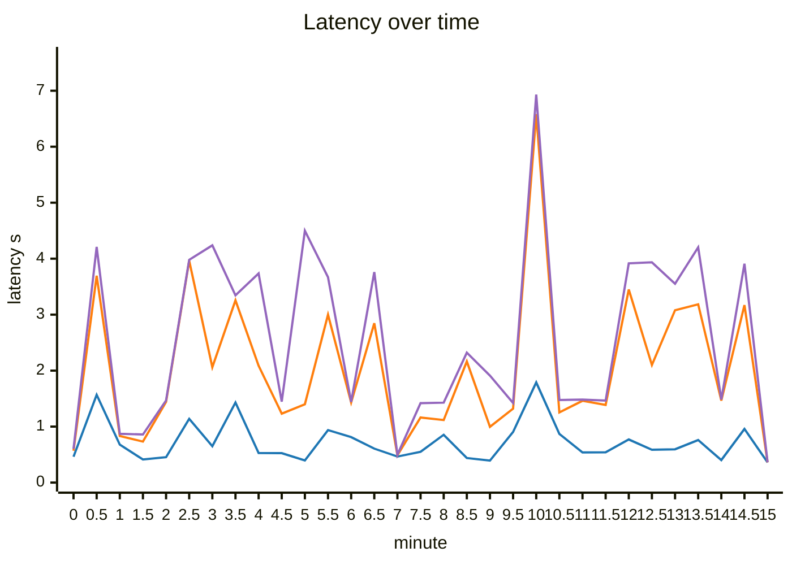
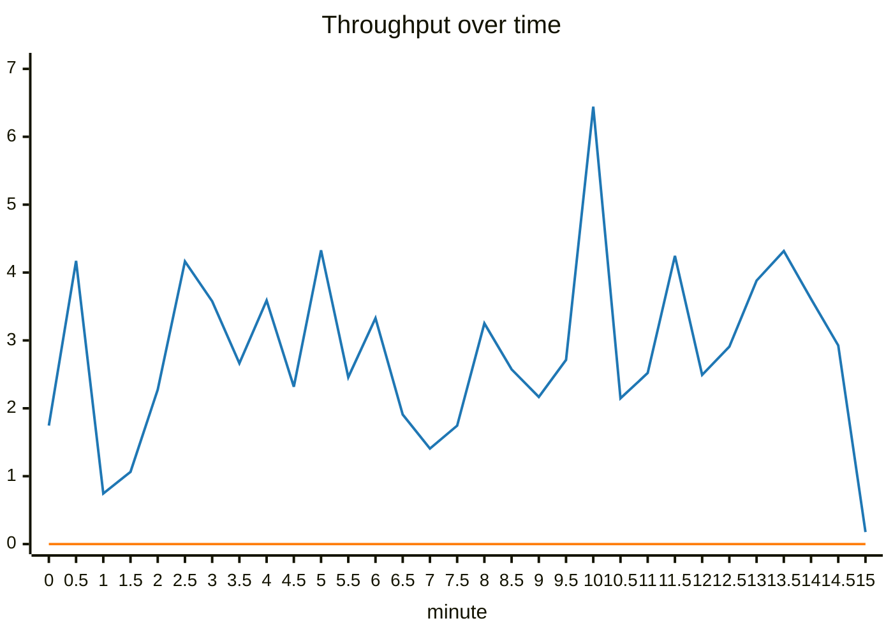

## normal — 2026-11-22 23:15 UTC

**PASS** · 918 s · 216 requests · 0 (0.0%) errors · 0 rate-limited · 2,635,755 tokens billed

15 min of Poisson traffic at 0.25 req/s; mix short20 60%, many100 10%, mid1k 10%, mid4k 10%, long8k 5%, long32k 5%. Billed 2,635,755 tokens.

|  | requests | errors | 429s | p50 s | p90 s | p99 s | max s | req/s | API tok/s | MRR |
|---|---|---|---|---|---|---|---|---|---|---|
| all | 216 | 0 (0.0%) | 0 | 0.584 | 3.228 | 5.873 | 6.930 | 0.240 | 2,929 | 0.802 |
| short20 | 119 | 0 (0.0%) | 0 | 0.493 | 1.248 | 4.151 | 6.115 | 0.132 | 1,159 | 0.653 |
| many100 | 26 | 0 (0.0%) | 0 | 1.446 | 1.783 | 2.050 | 2.097 | 0.029 | 936 | 0.942 |
| mid1k | 16 | 0 (0.0%) | 0 | 0.092 | 0.539 | 2.323 | 2.596 | 0.018 | 17.9 | 1.000 |
| mid4k | 22 | 0 (0.0%) | 0 | 0.402 | 0.889 | 1.669 | 1.772 | 0.024 | 93.0 | 1.000 |
| long8k | 15 | 0 (0.0%) | 0 | 0.869 | 2.314 | 6.030 | 6.634 | 0.017 | 127 | 1.000 |
| long32k | 18 | 0 (0.0%) | 0 | 3.749 | 4.317 | 6.517 | 6.930 | 0.020 | 596 | 1.000 |

*Latency over time: p50, p90, max*

*Throughput over time: API tokens/s ÷ 1000, errors*
