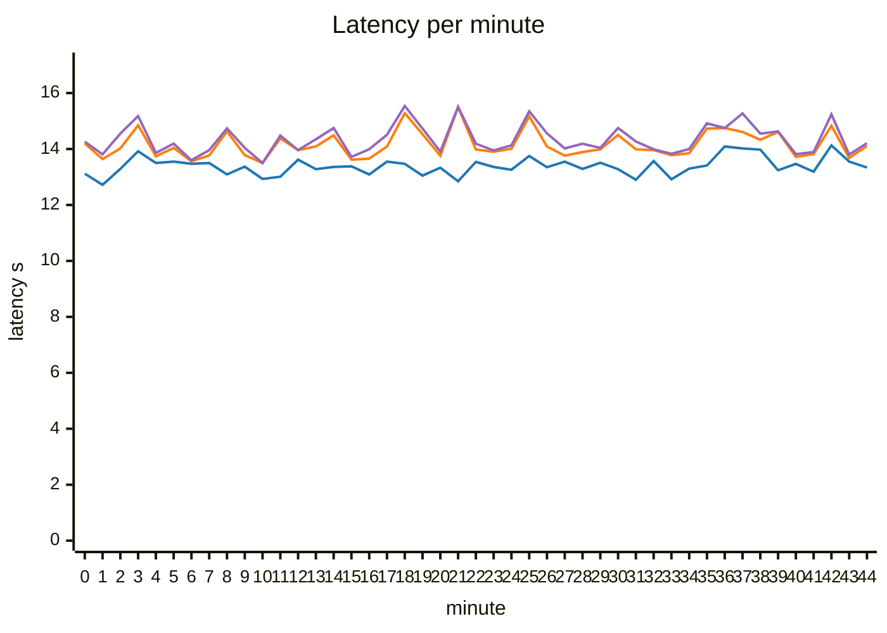
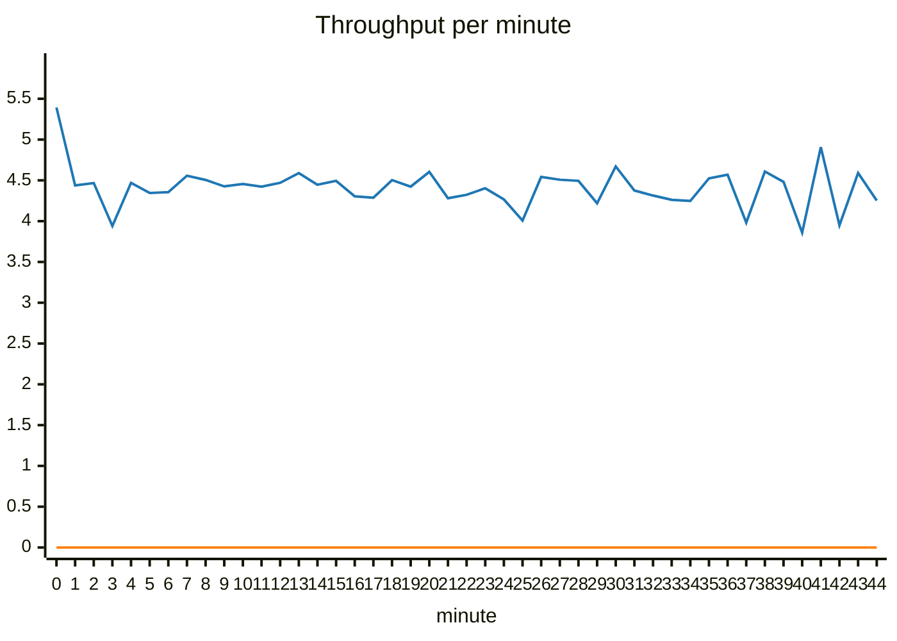

## hammer32k — 2026-11-22 23:51 UTC

**PASS** · 2710 s · 403 requests · 0 (0.0%) errors · 0 rate-limited · 11,912,158 tokens billed

45 min closed loop with 2 concurrent ~32K-token requests (350 distinct). 403 requests, 11,912,158 tokens billed.

|  | requests | errors | 429s | p50 s | p90 s | p99 s | max s | req/s | API tok/s | MRR |
|---|---|---|---|---|---|---|---|---|---|---|
| all | 403 | 0 (0.0%) | 0 | 13.5 | 14.3 | 15.3 | 15.5 | 0.149 | 4,412 | 0.996 |
| min 0–5 | 46 | 0 (0.0%) | 0 | 13.4 | 14.2 | 15.0 | 15.2 | 0.153 | 4,542 | 1.000 |
| min 5–10 | 45 | 0 (0.0%) | 0 | 13.4 | 14.0 | 14.7 | 14.7 | 0.150 | 4,438 | 1.000 |
| min 10–15 | 45 | 0 (0.0%) | 0 | 13.3 | 14.3 | 14.6 | 14.7 | 0.150 | 4,476 | 0.978 |
| min 15–20 | 45 | 0 (0.0%) | 0 | 13.4 | 14.4 | 15.4 | 15.5 | 0.150 | 4,402 | 1.000 |
| min 20–25 | 45 | 0 (0.0%) | 0 | 13.4 | 14.0 | 15.5 | 15.5 | 0.150 | 4,375 | 0.989 |
| min 25–30 | 44 | 0 (0.0%) | 0 | 13.5 | 14.1 | 15.2 | 15.4 | 0.147 | 4,354 | 1.000 |
| min 30–35 | 45 | 0 (0.0%) | 0 | 13.3 | 14.0 | 14.6 | 14.8 | 0.150 | 4,374 | 1.000 |
| min 35–40 | 44 | 0 (0.0%) | 0 | 13.9 | 14.7 | 15.1 | 15.3 | 0.147 | 4,434 | 1.000 |
| min 40–45 | 44 | 0 (0.0%) | 0 | 13.6 | 14.2 | 15.0 | 15.2 | 0.147 | 4,312 | 1.000 |

*Latency per minute: p50, p90, max*

*Throughput per minute: API tokens/s ÷ 1000, errors*
