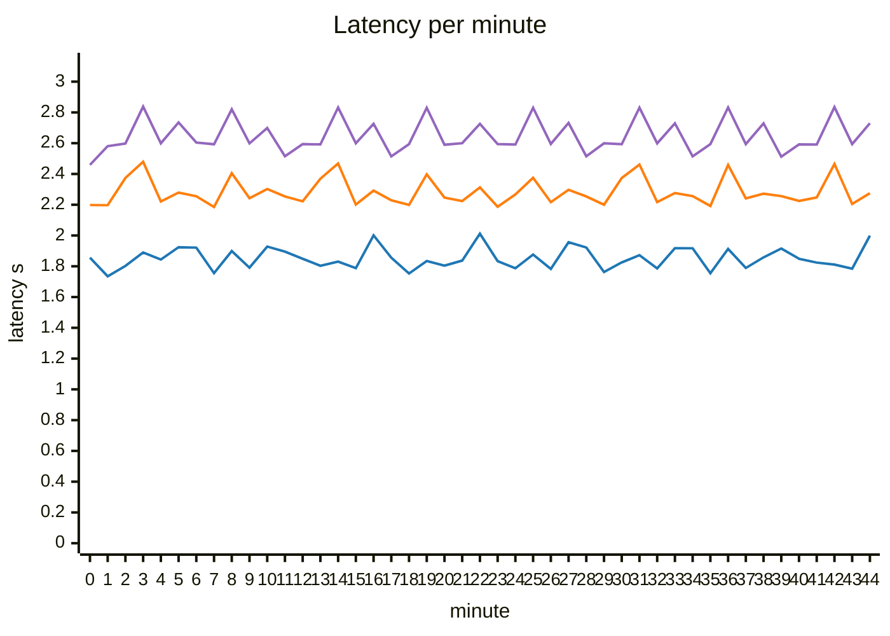
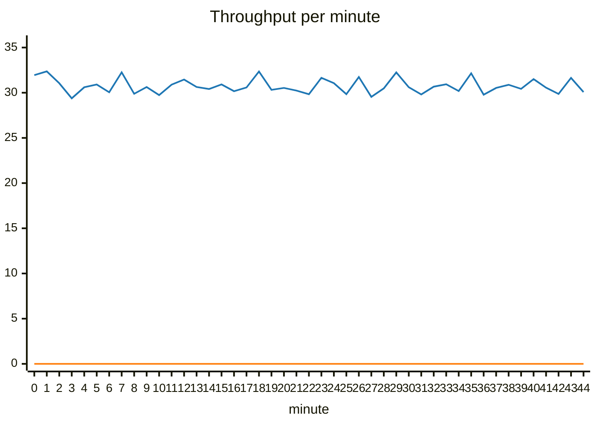

## hammer32k — 2026-11-23 00:05 UTC

**PASS** · 2702 s · 2807 requests · 0 (0.0%) errors · 0 rate-limited · 83,001,861 tokens billed

45 min closed loop with 2 concurrent ~32K-token requests (350 distinct). 2807 requests, 83,001,861 tokens billed.

|  | requests | errors | 429s | p50 s | p90 s | p99 s | max s | req/s | API tok/s | MRR |
|---|---|---|---|---|---|---|---|---|---|---|
| all | 2,807 | 0 (0.0%) | 0 | 1.842 | 2.269 | 2.599 | 2.838 | 1.040 | 30,741 | 0.981 |
| min 0–5 | 316 | 0 (0.0%) | 0 | 1.824 | 2.242 | 2.597 | 2.838 | 1.053 | 31,068 | 0.983 |
| min 5–10 | 311 | 0 (0.0%) | 0 | 1.847 | 2.283 | 2.604 | 2.820 | 1.037 | 30,749 | 0.983 |
| min 10–15 | 311 | 0 (0.0%) | 0 | 1.849 | 2.281 | 2.596 | 2.832 | 1.037 | 30,628 | 0.980 |
| min 15–20 | 313 | 0 (0.0%) | 0 | 1.839 | 2.262 | 2.599 | 2.830 | 1.043 | 30,869 | 0.976 |
| min 20–25 | 311 | 0 (0.0%) | 0 | 1.840 | 2.252 | 2.591 | 2.726 | 1.037 | 30,662 | 0.982 |
| min 25–30 | 312 | 0 (0.0%) | 0 | 1.852 | 2.265 | 2.598 | 2.830 | 1.040 | 30,770 | 0.982 |
| min 30–35 | 309 | 0 (0.0%) | 0 | 1.860 | 2.278 | 2.599 | 2.831 | 1.030 | 30,445 | 0.982 |
| min 35–40 | 312 | 0 (0.0%) | 0 | 1.837 | 2.292 | 2.594 | 2.832 | 1.040 | 30,752 | 0.981 |
| min 40–45 | 312 | 0 (0.0%) | 0 | 1.840 | 2.265 | 2.594 | 2.835 | 1.040 | 30,730 | 0.979 |

*Latency per minute: p50, p90, max*

*Throughput per minute: API tokens/s ÷ 1000, errors*
