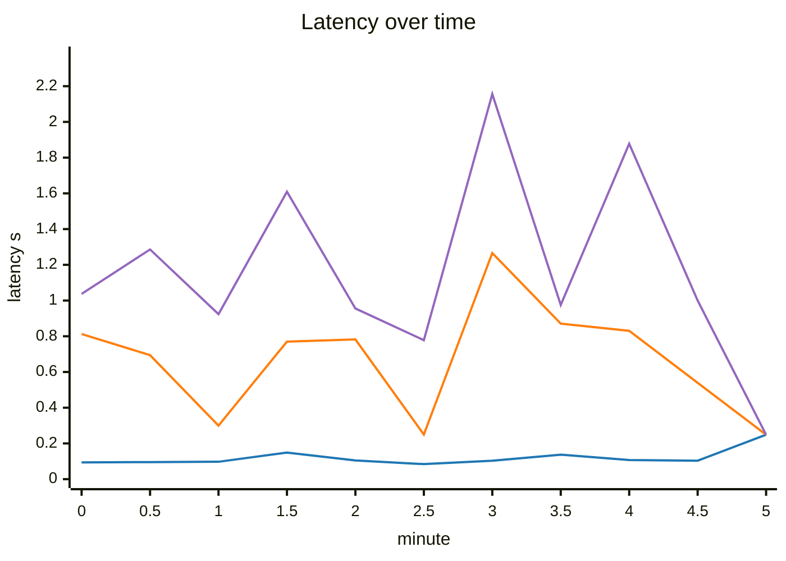
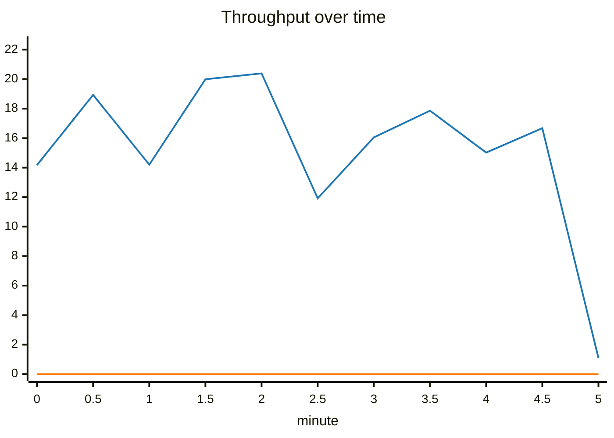

## normal — 2026-11-23 00:00 UTC

**PASS** · 301 s · 436 requests · 0 (0.0%) errors · 0 rate-limited · 4,988,682 tokens billed

5 min of Poisson traffic at 1.5 req/s; mix short20 60%, many100 10%, mid1k 10%, mid4k 10%, long8k 5%, long32k 5%. Billed 4,988,682 tokens.

|  | requests | errors | 429s | p50 s | p90 s | p99 s | max s | req/s | API tok/s | MRR |
|---|---|---|---|---|---|---|---|---|---|---|
| all | 436 | 0 (0.0%) | 0 | 0.103 | 0.793 | 1.604 | 2.156 | 1.453 | 16,629 | 0.795 |
| short20 | 241 | 0 (0.0%) | 0 | 0.091 | 0.389 | 1.457 | 1.674 | 0.803 | 6,868 | 0.637 |
| many100 | 47 | 0 (0.0%) | 0 | 0.246 | 0.569 | 1.321 | 1.418 | 0.157 | 5,081 | 0.968 |
| mid1k | 42 | 0 (0.0%) | 0 | 0.025 | 0.274 | 1.263 | 1.660 | 0.140 | 140 | 1.000 |
| mid4k | 43 | 0 (0.0%) | 0 | 0.084 | 0.222 | 0.456 | 0.569 | 0.143 | 545 | 1.000 |
| long8k | 31 | 0 (0.0%) | 0 | 0.195 | 0.965 | 1.468 | 1.593 | 0.103 | 789 | 1.000 |
| long32k | 32 | 0 (0.0%) | 0 | 0.895 | 1.286 | 2.070 | 2.156 | 0.107 | 3,206 | 0.984 |

*Latency over time: p50, p90, max*

*Throughput over time: API tokens/s ÷ 1000, errors*
