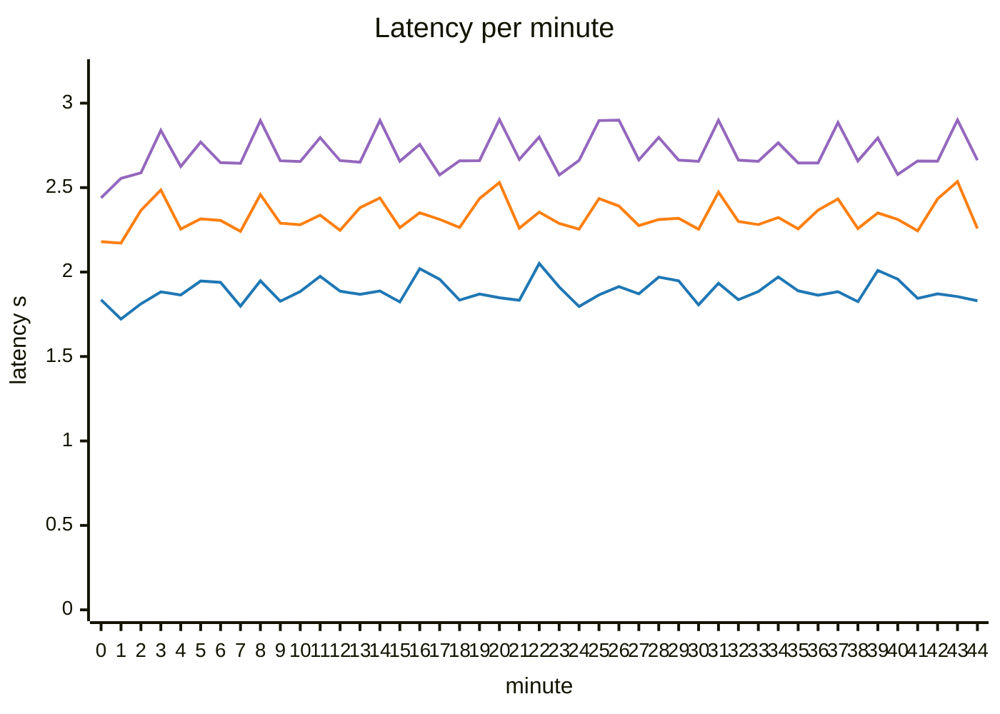
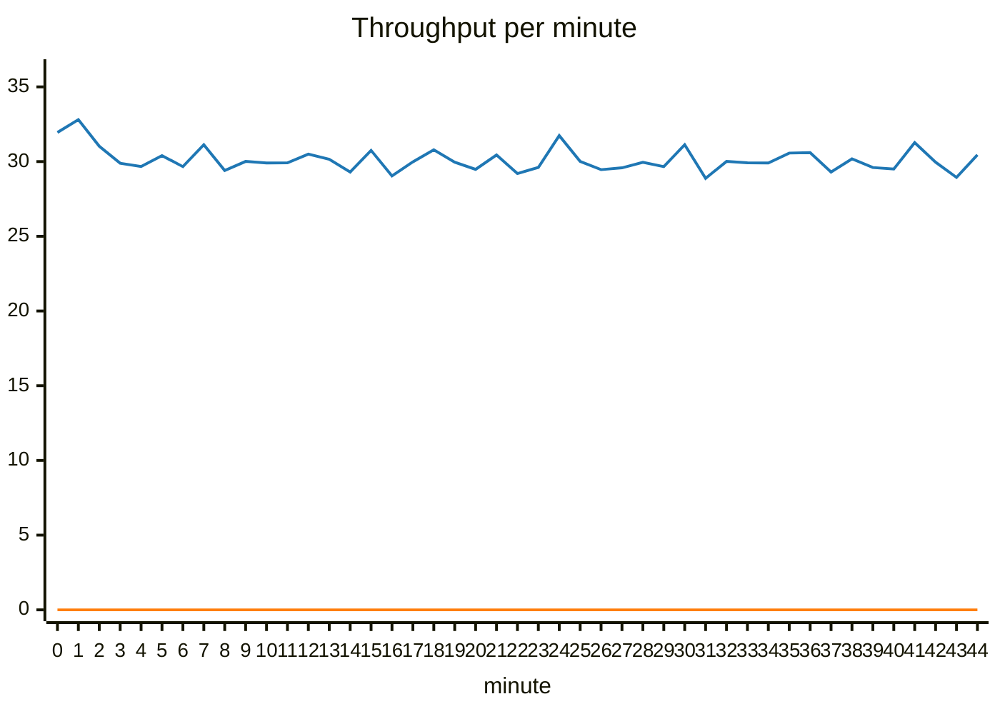

## hammer32k — 2026-11-23 00:26 UTC

**PASS** · 2702 s · 2751 requests · 0 (0.0%) errors · 0 rate-limited · 81,336,273 tokens billed

45 min closed loop with 2 concurrent ~32K-token requests (350 distinct). 2751 requests, 81,336,273 tokens billed.

|  | requests | errors | 429s | p50 s | p90 s | p99 s | max s | req/s | API tok/s | MRR |
|---|---|---|---|---|---|---|---|---|---|---|
| all | 2,751 | 0 (0.0%) | 0 | 1.883 | 2.319 | 2.662 | 2.903 | 1.019 | 30,125 | 0.981 |
| min 0–5 | 316 | 0 (0.0%) | 0 | 1.814 | 2.251 | 2.623 | 2.839 | 1.053 | 31,068 | 0.979 |
| min 5–10 | 305 | 0 (0.0%) | 0 | 1.887 | 2.321 | 2.659 | 2.897 | 1.017 | 30,121 | 0.984 |
| min 10–15 | 304 | 0 (0.0%) | 0 | 1.892 | 2.329 | 2.660 | 2.898 | 1.013 | 29,957 | 0.979 |
| min 15–20 | 305 | 0 (0.0%) | 0 | 1.892 | 2.315 | 2.656 | 2.756 | 1.017 | 30,104 | 0.980 |
| min 20–25 | 305 | 0 (0.0%) | 0 | 1.892 | 2.308 | 2.666 | 2.903 | 1.017 | 30,093 | 0.979 |
| min 25–30 | 302 | 0 (0.0%) | 0 | 1.909 | 2.337 | 2.664 | 2.900 | 1.007 | 29,732 | 0.981 |
| min 30–35 | 304 | 0 (0.0%) | 0 | 1.870 | 2.347 | 2.663 | 2.899 | 1.013 | 29,971 | 0.981 |
| min 35–40 | 305 | 0 (0.0%) | 0 | 1.884 | 2.321 | 2.657 | 2.885 | 1.017 | 30,051 | 0.979 |
| min 40–45 | 305 | 0 (0.0%) | 0 | 1.871 | 2.313 | 2.658 | 2.901 | 1.017 | 30,025 | 0.985 |

*Latency per minute: p50, p90, max*

*Throughput per minute: API tokens/s ÷ 1000, errors*
