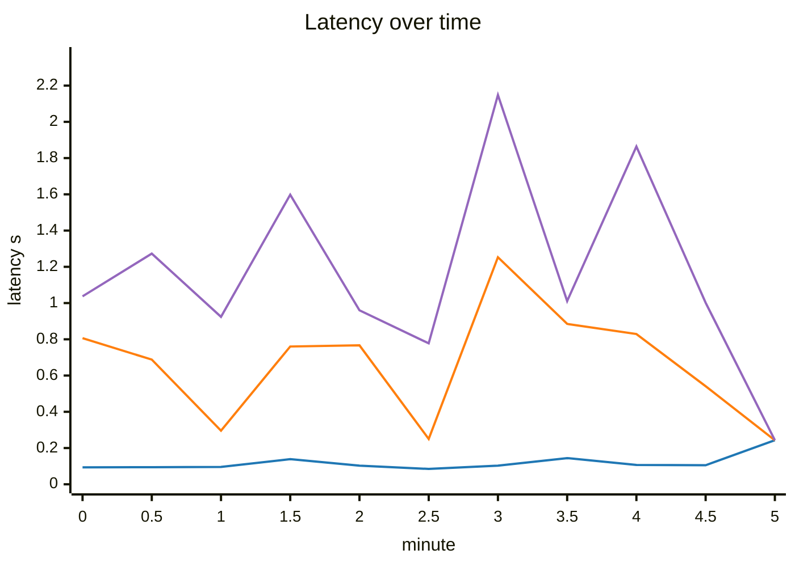
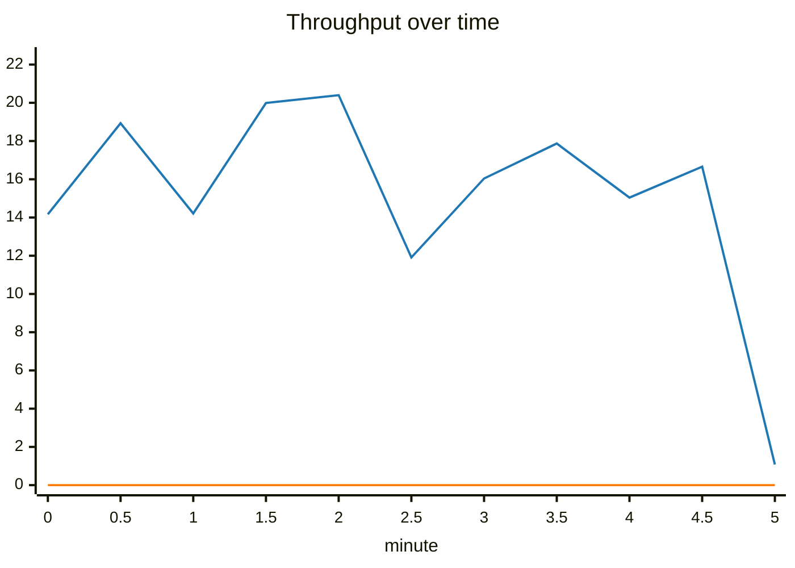

## normal — 2026-11-23 00:21 UTC

**PASS** · 301 s · 436 requests · 0 (0.0%) errors · 0 rate-limited · 4,988,441 tokens billed

5 min of Poisson traffic at 1.5 req/s; mix short20 60%, many100 10%, mid1k 10%, mid4k 10%, long8k 5%, long32k 5%. Billed 4,988,441 tokens.

|  | requests | errors | 429s | p50 s | p90 s | p99 s | max s | req/s | API tok/s | MRR |
|---|---|---|---|---|---|---|---|---|---|---|
| all | 436 | 0 (0.0%) | 0 | 0.102 | 0.806 | 1.594 | 2.148 | 1.453 | 16,628 | 0.795 |
| short20 | 241 | 0 (0.0%) | 0 | 0.092 | 0.378 | 1.444 | 1.661 | 0.803 | 6,868 | 0.637 |
| many100 | 47 | 0 (0.0%) | 0 | 0.246 | 0.560 | 1.311 | 1.409 | 0.157 | 5,080 | 0.968 |
| mid1k | 42 | 0 (0.0%) | 0 | 0.025 | 0.276 | 1.254 | 1.648 | 0.140 | 140 | 1.000 |
| mid4k | 43 | 0 (0.0%) | 0 | 0.084 | 0.218 | 0.449 | 0.560 | 0.143 | 545 | 1.000 |
| long8k | 31 | 0 (0.0%) | 0 | 0.194 | 0.967 | 1.459 | 1.586 | 0.103 | 789 | 1.000 |
| long32k | 32 | 0 (0.0%) | 0 | 0.880 | 1.279 | 2.060 | 2.148 | 0.107 | 3,206 | 0.984 |

*Latency over time: p50, p90, max*

*Throughput over time: API tokens/s ÷ 1000, errors*
