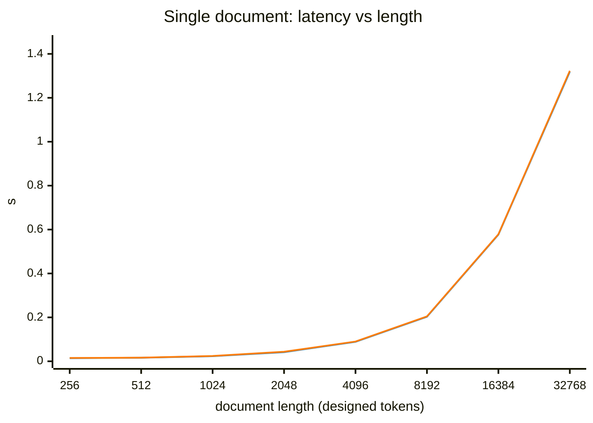
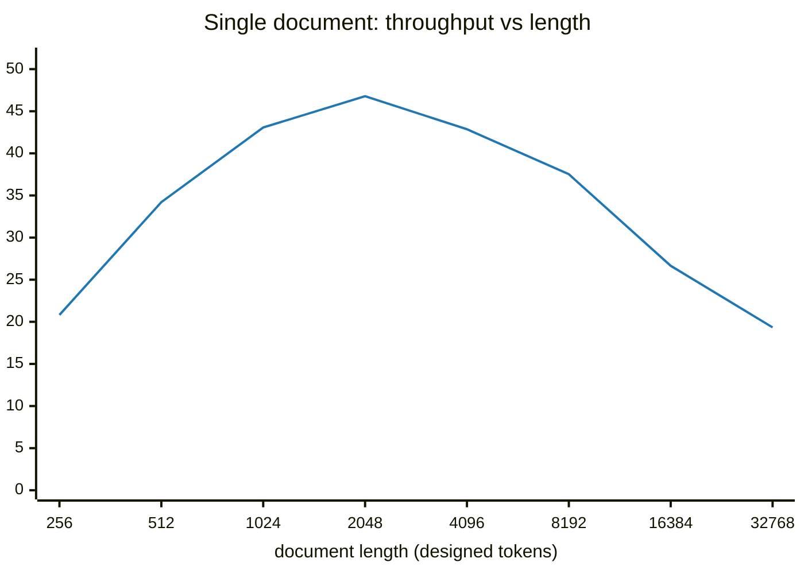
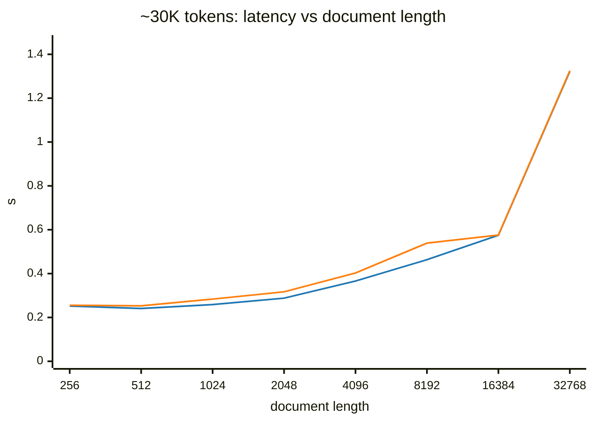
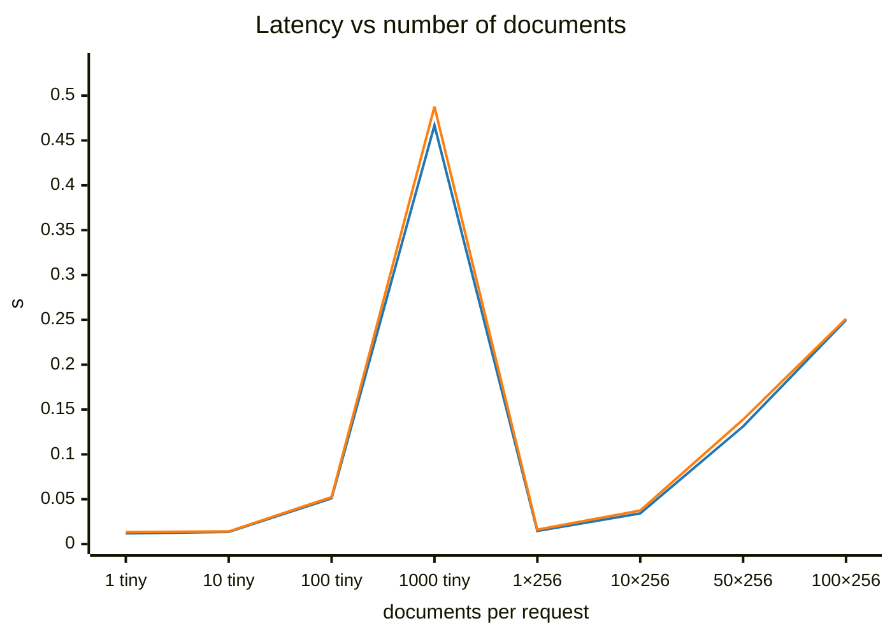
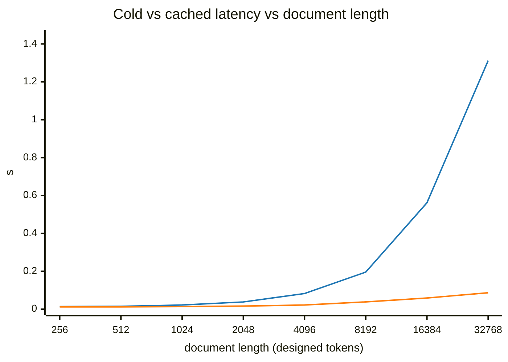
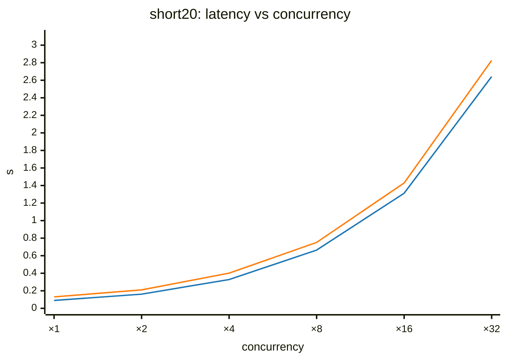
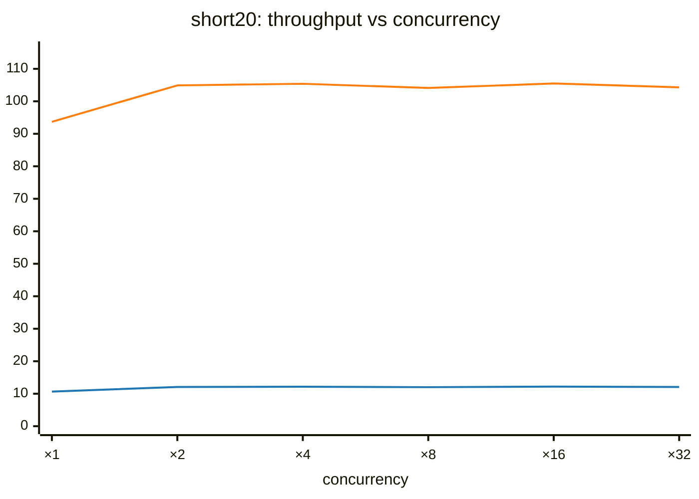
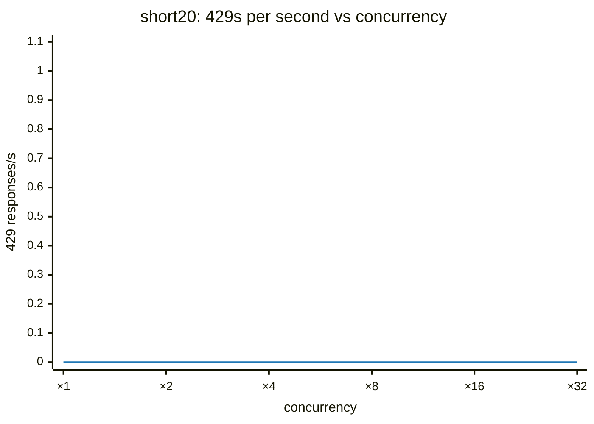

## meticulous — 2026-11-23 00:52 UTC

**PASS** · 327 s · 2433 requests · 0 (0.0%) errors · 0 rate-limited · 23,327,698 tokens billed

Sequential requests (one in flight) unless stated; every query carries a nonce so nothing is served from the API's prefix cache.

### Single document: latency vs length

| rung | Qwen tokens | billed | errors | p50 s | p90 s | max s | API tok/s |
|---|---|---|---|---|---|---|---|
| 256 | 229 | 324 | 0 (0.0%) | 0.014 | 0.015 | 0.047 | 20,819 |
| 512 | 457 | 551 | 0 (0.0%) | 0.016 | 0.017 | 0.017 | 34,211 |
| 1,024 | 911 | 1,005 | 0 (0.0%) | 0.023 | 0.024 | 0.025 | 43,066 |
| 2,048 | 1,872 | 1,966 | 0 (0.0%) | 0.042 | 0.044 | 0.044 | 46,787 |
| 4,096 | 3,707 | 3,801 | 0 (0.0%) | 0.088 | 0.090 | 0.093 | 42,860 |
| 8,192 | 7,545 | 7,640 | 0 (0.0%) | 0.203 | 0.204 | 0.209 | 37,522 |
| 16,384 | 15,274 | 15,368 | 0 (0.0%) | 0.577 | 0.579 | 0.580 | 26,653 |
| 32,768 | 25,438 | 25,536 | 0 (0.0%) | 1.319 | 1.323 | 1.325 | 19,341 |

*Single document: latency vs length: p50, p90*

*Single document: throughput vs length: API tokens/s ÷ 1000*

### ~30K tokens per request: latency vs document length (fewer, longer documents)

| rung | docs/request | billed | errors | p50 s | p90 s | max s | API tok/s |
|---|---|---|---|---|---|---|---|
| 256 | 100 | 32,432 | 0 (0.0%) | 0.252 | 0.256 | 0.257 | 128,583 |
| 512 | 55 | 30,289 | 0 (0.0%) | 0.241 | 0.253 | 0.271 | 124,604 |
| 1,024 | 28 | 28,179 | 0 (0.0%) | 0.259 | 0.284 | 0.293 | 107,981 |
| 2,048 | 13 | 25,569 | 0 (0.0%) | 0.288 | 0.317 | 0.340 | 90,337 |
| 4,096 | 6 | 22,809 | 0 (0.0%) | 0.366 | 0.403 | 0.423 | 63,553 |
| 8,192 | 3 | 22,923 | 0 (0.0%) | 0.463 | 0.539 | 0.595 | 50,335 |
| 16,384 | 1 | 15,367 | 0 (0.0%) | 0.575 | 0.576 | 0.577 | 26,751 |
| 32,768 | 1 | 25,541 | 0 (0.0%) | 1.322 | 1.325 | 1.326 | 19,309 |

*~30K tokens: latency vs document length: p50, p90*

### Latency vs number of documents

| documents | billed | errors | p50 s | p90 s | max s | MRR |
|---|---|---|---|---|---|---|
| 1 tiny | 91.2 | 0 (0.0%) | 0.012 | 0.013 | 0.014 | 1.000 |
| 10 tiny | 922 | 0 (0.0%) | 0.014 | 0.014 | 0.014 | 1.000 |
| 100 tiny | 9,309 | 0 (0.0%) | 0.051 | 0.052 | 0.053 | 1.000 |
| 1000 tiny | 93,389 | 0 (0.0%) | 0.467 | 0.488 | 0.488 | 0.950 |
| 1×256 | 323 | 0 (0.0%) | 0.015 | 0.016 | 0.018 | 1.000 |
| 10×256 | 3,238 | 0 (0.0%) | 0.034 | 0.037 | 0.039 | 1.000 |
| 50×256 | 16,145 | 0 (0.0%) | 0.131 | 0.139 | 0.143 | 1.000 |
| 100×256 | 32,319 | 0 (0.0%) | 0.250 | 0.251 | 0.256 | 1.000 |

*Latency vs number of documents: p50, p90*

### Cold vs cached: the same single-document request sent twice in a row

The API caches prompt prefixes, so a repeated (query, document) pair skips most of the compute. Cold = fresh nonce in the query; cached = the identical request again immediately after.

| rung | pairs | cold p50 s | cached p50 s | speed-up × | cold max s | cached max s | errors |
|---|---|---|---|---|---|---|---|
| 256 | 10 | 0.014 | 0.012 | 1.158 | 0.042 | 0.013 |  |
| 512 | 10 | 0.015 | 0.012 | 1.239 | 0.016 | 0.013 |  |
| 1,024 | 10 | 0.022 | 0.014 | 1.632 | 0.022 | 0.014 |  |
| 2,048 | 10 | 0.038 | 0.016 | 2.345 | 0.040 | 0.017 |  |
| 4,096 | 10 | 0.083 | 0.022 | 3.729 | 0.084 | 0.023 |  |
| 8,192 | 10 | 0.196 | 0.038 | 5.089 | 0.197 | 0.041 |  |
| 16,384 | 10 | 0.562 | 0.059 | 9.497 | 0.565 | 0.061 |  |
| 32,768 | 10 | 1.312 | 0.087 | 15.1 | 1.317 | 0.087 |  |

*Cold vs cached latency vs document length: cold p50, cached p50*

### short20: latency and throughput vs concurrency

|  | requests | errors | 429s | p50 s | p90 s | p99 s | max s | req/s | API tok/s | MRR |
|---|---|---|---|---|---|---|---|---|---|---|
| ×1 | 267 | 0 (0.0%) | 0 | 0.090 | 0.131 | 0.167 | 0.172 | 10.7 | 93,704 | 0.647 |
| ×2 | 303 | 0 (0.0%) | 0 | 0.161 | 0.210 | 0.254 | 0.263 | 12.1 | 104,946 | 0.642 |
| ×4 | 306 | 0 (0.0%) | 0 | 0.328 | 0.401 | 0.464 | 0.533 | 12.1 | 105,387 | 0.638 |
| ×8 | 307 | 0 (0.0%) | 0 | 0.664 | 0.751 | 0.859 | 0.874 | 12.0 | 104,144 | 0.646 |
| ×16 | 319 | 0 (0.0%) | 0 | 1.312 | 1.429 | 1.493 | 1.524 | 12.2 | 105,458 | 0.634 |
| ×32 | 331 | 0 (0.0%) | 0 | 2.642 | 2.826 | 2.954 | 2.997 | 12.1 | 104,273 | 0.637 |

No 429s up to concurrency ×32.

*short20: latency vs concurrency: p50, p90*

*short20: throughput vs concurrency: req/s, API tokens/s ÷ 1000*

*short20: 429s per second vs concurrency: 429/s*

2433 requests, 23,327,698 tokens billed.
