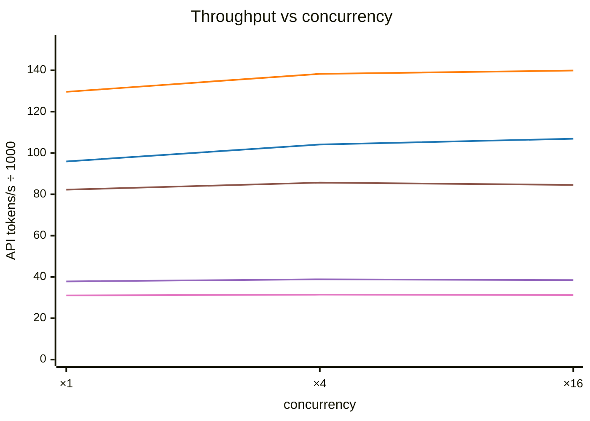
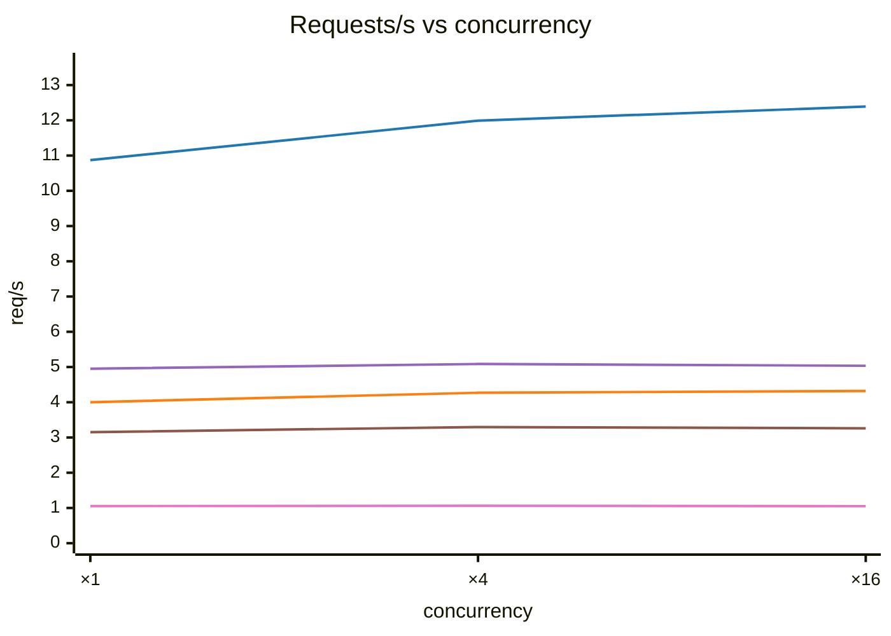
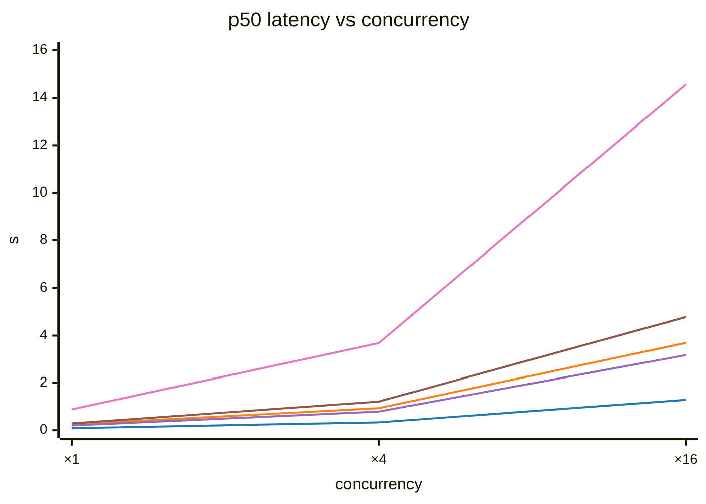

## speed — 2026-11-23 00:57 UTC

**PASS** · 441 s · 1994 requests · 0 (0.0%) errors · 0 rate-limited · 31,506,865 tokens billed

Closed loop, 25 s per cell, 5 request classes × concurrency [1, 4, 16]. 1994 requests, 31,506,865 tokens billed.

|  | requests | errors | 429s | p50 s | p90 s | p99 s | max s | req/s | API tok/s | MRR |
|---|---|---|---|---|---|---|---|---|---|---|
| short20 ×1 | 273 | 0 (0.0%) | 0 | 0.088 | 0.127 | 0.165 | 0.175 | 10.9 | 95,911 | 0.646 |
| short20 ×4 | 303 | 0 (0.0%) | 0 | 0.334 | 0.407 | 0.466 | 0.537 | 12.0 | 104,149 | 0.639 |
| short20 ×16 | 324 | 0 (0.0%) | 0 | 1.284 | 1.403 | 1.469 | 1.534 | 12.4 | 106,925 | 0.642 |
| many100 ×1 | 101 | 0 (0.0%) | 0 | 0.248 | 0.256 | 0.266 | 0.269 | 4.001 | 129,598 | 0.980 |
| many100 ×4 | 110 | 0 (0.0%) | 0 | 0.933 | 0.950 | 0.995 | 1.021 | 4.269 | 138,271 | 0.982 |
| many100 ×16 | 124 | 0 (0.0%) | 0 | 3.693 | 3.718 | 3.766 | 3.985 | 4.321 | 139,924 | 0.984 |
| long8k ×1 | 124 | 0 (0.0%) | 0 | 0.202 | 0.203 | 0.206 | 0.208 | 4.952 | 37,835 | 1.000 |
| long8k ×4 | 131 | 0 (0.0%) | 0 | 0.790 | 0.799 | 0.801 | 0.801 | 5.085 | 38,850 | 1.000 |
| long8k ×16 | 141 | 0 (0.0%) | 0 | 3.177 | 3.201 | 3.211 | 3.276 | 5.035 | 38,473 | 1.000 |
| pack32k ×1 | 79 | 0 (0.0%) | 0 | 0.287 | 0.473 | 0.546 | 0.584 | 3.152 | 82,261 | 1.000 |
| pack32k ×4 | 87 | 0 (0.0%) | 0 | 1.212 | 1.402 | 1.511 | 1.517 | 3.296 | 85,639 | 1.000 |
| pack32k ×16 | 98 | 0 (0.0%) | 0 | 4.785 | 5.155 | 5.293 | 5.323 | 3.261 | 84,532 | 1.000 |
| long32k ×1 | 27 | 0 (0.0%) | 0 | 0.884 | 1.307 | 1.311 | 1.312 | 1.055 | 31,068 | 1.000 |
| long32k ×4 | 30 | 0 (0.0%) | 0 | 3.682 | 4.304 | 4.400 | 4.407 | 1.061 | 31,428 | 1.000 |
| long32k ×16 | 42 | 0 (0.0%) | 0 | 14.6 | 16.1 | 16.3 | 16.3 | 1.051 | 31,223 | 0.988 |

*Throughput vs concurrency: short20, many100, long8k, pack32k, long32k*

*Requests/s vs concurrency: short20, many100, long8k, pack32k, long32k*

*p50 latency vs concurrency: short20, many100, long8k, pack32k, long32k*
