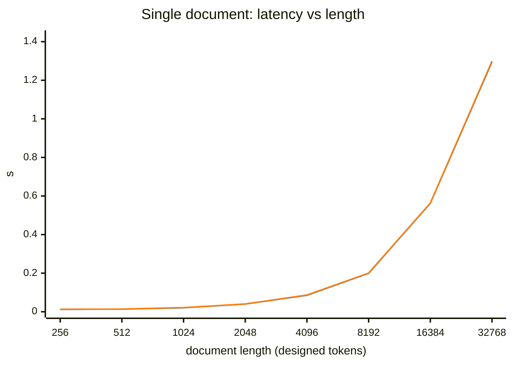
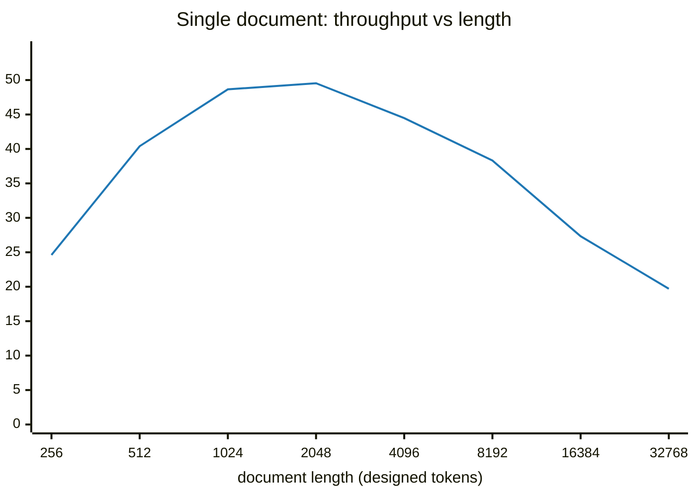
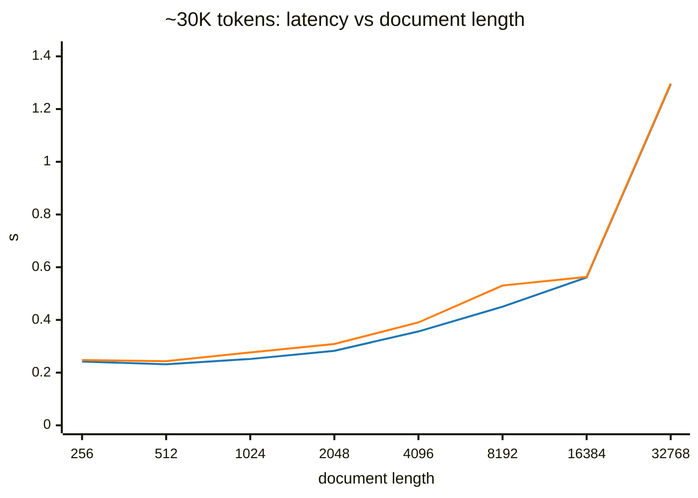
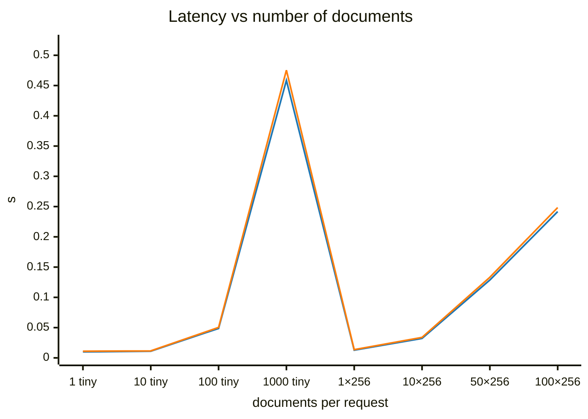
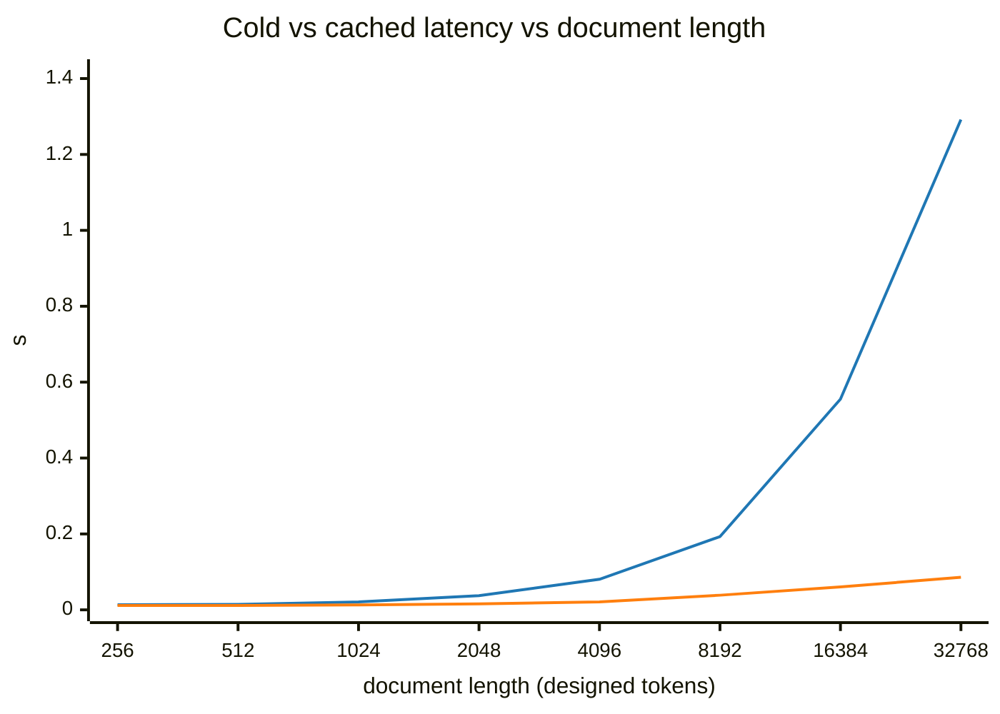
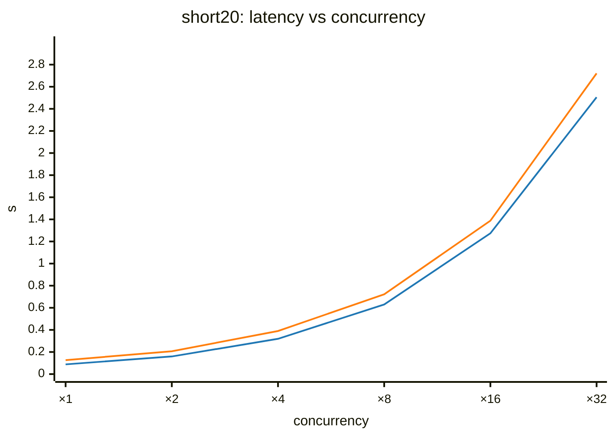
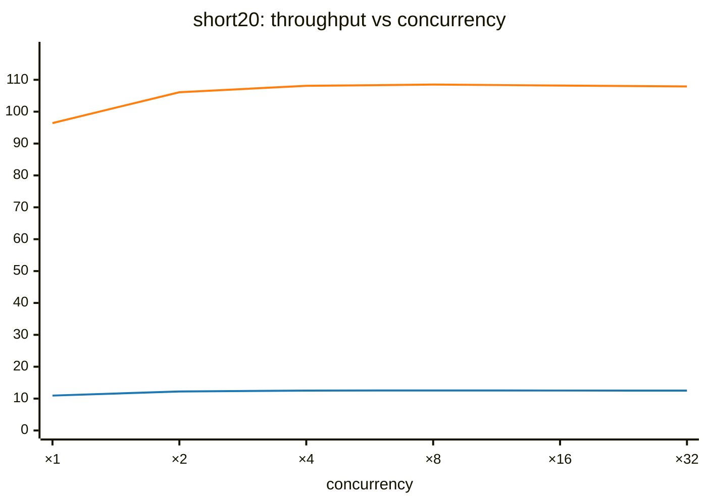
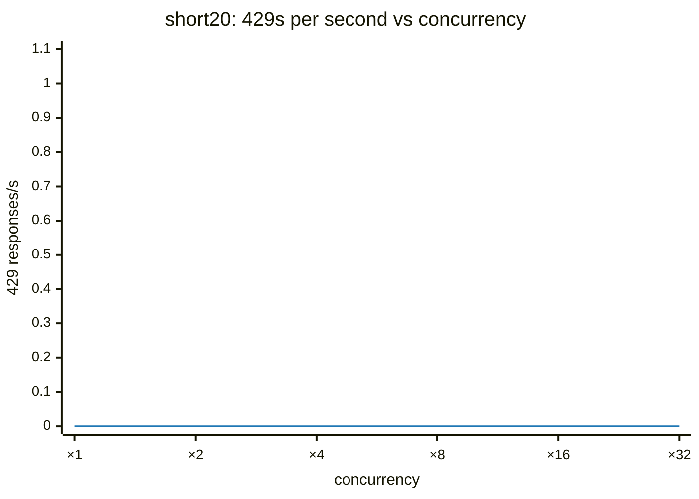

## meticulous — 2026-11-23 01:06 UTC

**PASS** · 323 s · 2489 requests · 1 (0.0%) errors · 0 rate-limited · 23,780,888 tokens billed

Sequential requests (one in flight) unless stated; every query carries a nonce so nothing is served from the API's prefix cache.

### Single document: latency vs length

| rung | Qwen tokens | billed | errors | p50 s | p90 s | max s | API tok/s |
|---|---|---|---|---|---|---|---|
| 256 | 229 | 323 | 0 (0.0%) | 0.012 | 0.013 | 0.038 | 24,610 |
| 512 | 457 | 551 | 0 (0.0%) | 0.014 | 0.014 | 0.015 | 40,405 |
| 1,024 | 911 | 1,005 | 0 (0.0%) | 0.020 | 0.022 | 0.023 | 48,651 |
| 2,048 | 1,872 | 1,966 | 0 (0.0%) | 0.040 | 0.040 | 0.041 | 49,538 |
| 4,096 | 3,707 | 3,800 | 0 (0.0%) | 0.085 | 0.087 | 0.087 | 44,478 |
| 8,192 | 7,545 | 7,640 | 0 (0.0%) | 0.199 | 0.201 | 0.202 | 38,318 |
| 16,384 | 15,274 | 15,368 | 0 (0.0%) | 0.562 | 0.564 | 0.564 | 27,331 |
| 32,768 | 25,438 | 25,536 | 0 (0.0%) | 1.295 | 1.299 | 1.303 | 19,713 |

*Single document: latency vs length: p50, p90*

*Single document: throughput vs length: API tokens/s ÷ 1000*

### ~30K tokens per request: latency vs document length (fewer, longer documents)

| rung | docs/request | billed | errors | p50 s | p90 s | max s | API tok/s |
|---|---|---|---|---|---|---|---|
| 256 | 100 | 32,372 | 0 (0.0%) | 0.242 | 0.248 | 0.251 | 132,960 |
| 512 | 55 | 30,286 | 0 (0.0%) | 0.232 | 0.244 | 0.260 | 129,421 |
| 1,024 | 28 | 28,176 | 0 (0.0%) | 0.252 | 0.277 | 0.284 | 111,317 |
| 2,048 | 13 | 25,565 | 0 (0.0%) | 0.283 | 0.309 | 0.337 | 92,715 |
| 4,096 | 6 | 22,808 | 0 (0.0%) | 0.356 | 0.390 | 0.415 | 65,449 |
| 8,192 | 3 | 22,923 | 0 (0.0%) | 0.450 | 0.530 | 0.577 | 51,619 |
| 16,384 | 1 | 15,367 | 0 (0.0%) | 0.561 | 0.563 | 0.564 | 27,382 |
| 32,768 | 1 | 25,540 | 0 (0.0%) | 1.294 | 1.297 | 1.304 | 19,728 |

*~30K tokens: latency vs document length: p50, p90*

### Latency vs number of documents

| documents | billed | errors | p50 s | p90 s | max s | MRR |
|---|---|---|---|---|---|---|
| 1 tiny | 91.3 | 0 (0.0%) | 0.010 | 0.011 | 0.012 | 1.000 |
| 10 tiny | 921 | 0 (0.0%) | 0.011 | 0.012 | 0.012 | 1.000 |
| 100 tiny | 9,329 | 0 (0.0%) | 0.049 | 0.050 | 0.051 | 1.000 |
| 1000 tiny | 93,989 | 0 (0.0%) | 0.458 | 0.475 | 0.476 | 0.833 |
| 1×256 | 323 | 0 (0.0%) | 0.013 | 0.014 | 0.016 | 1.000 |
| 10×256 | 3,228 | 0 (0.0%) | 0.032 | 0.034 | 0.037 | 1.000 |
| 50×256 | 16,155 | 0 (0.0%) | 0.129 | 0.133 | 0.138 | 1.000 |
| 100×256 | 32,309 | 0 (0.0%) | 0.242 | 0.248 | 0.249 | 1.000 |

*Latency vs number of documents: p50, p90*

### Cold vs cached: the same single-document request sent twice in a row

The API caches prompt prefixes, so a repeated (query, document) pair skips most of the compute. Cold = fresh nonce in the query; cached = the identical request again immediately after.

| rung | pairs | cold p50 s | cached p50 s | speed-up × | cold max s | cached max s | errors |
|---|---|---|---|---|---|---|---|
| 256 | 10 | 0.013 | 0.012 | 1.157 | 0.031 | 0.013 |  |
| 512 | 10 | 0.015 | 0.011 | 1.280 | 0.015 | 0.012 |  |
| 1,024 | 10 | 0.021 | 0.013 | 1.613 | 0.021 | 0.014 |  |
| 2,048 | 10 | 0.037 | 0.016 | 2.371 | 0.038 | 0.016 |  |
| 4,096 | 10 | 0.081 | 0.021 | 3.836 | 0.082 | 0.022 |  |
| 8,192 | 10 | 0.193 | 0.039 | 5.007 | 0.199 | 0.040 |  |
| 16,384 | 10 | 0.555 | 0.060 | 9.217 | 0.557 | 0.062 |  |
| 32,768 | 10 | 1.292 | 0.086 | 15.0 | 1.297 | 0.089 |  |

*Cold vs cached latency vs document length: cold p50, cached p50*

### short20: latency and throughput vs concurrency

|  | requests | errors | 429s | p50 s | p90 s | p99 s | max s | req/s | API tok/s | MRR |
|---|---|---|---|---|---|---|---|---|---|---|
| ×1 | 275 | 1 (0.4%) | 0 | 0.088 | 0.127 | 0.160 | 0.169 | 10.9 | 96,417 | 0.656 |
| ×2 | 307 | 0 (0.0%) | 0 | 0.160 | 0.207 | 0.250 | 0.257 | 12.2 | 106,076 | 0.640 |
| ×4 | 316 | 0 (0.0%) | 0 | 0.319 | 0.390 | 0.456 | 0.515 | 12.5 | 108,053 | 0.635 |
| ×8 | 321 | 0 (0.0%) | 0 | 0.630 | 0.722 | 0.821 | 0.870 | 12.6 | 108,528 | 0.634 |
| ×16 | 328 | 0 (0.0%) | 0 | 1.274 | 1.388 | 1.456 | 1.489 | 12.5 | 108,214 | 0.636 |
| ×32 | 342 | 0 (0.0%) | 0 | 2.505 | 2.721 | 2.825 | 2.876 | 12.5 | 107,925 | 0.637 |

No 429s up to concurrency ×32.

*short20: latency vs concurrency: p50, p90*

*short20: throughput vs concurrency: req/s, API tokens/s ÷ 1000*

*short20: 429s per second vs concurrency: 429/s*

| error | count | example | response |
|---|---|---|---|
| http 424 ModelError container 0 | 1 | beir-arguana beir-arguana/test-economy-thsptr-pro03a | {"ErrorCode":"INTERNAL_FAILURE_FROM_MODEL","LogStreamArn":"arn:aws:logs:eu-west-3:<account-id>:log-group:/aws/sagemaker/Endpoints/reranker-tl-06b-q3","Message":"Received server error (0) from primary with message \"Connection reset by peer for the reranker-tl-06b-q3 endpoint. Please retry.\". See  |

2489 requests, 23,780,888 tokens billed.
