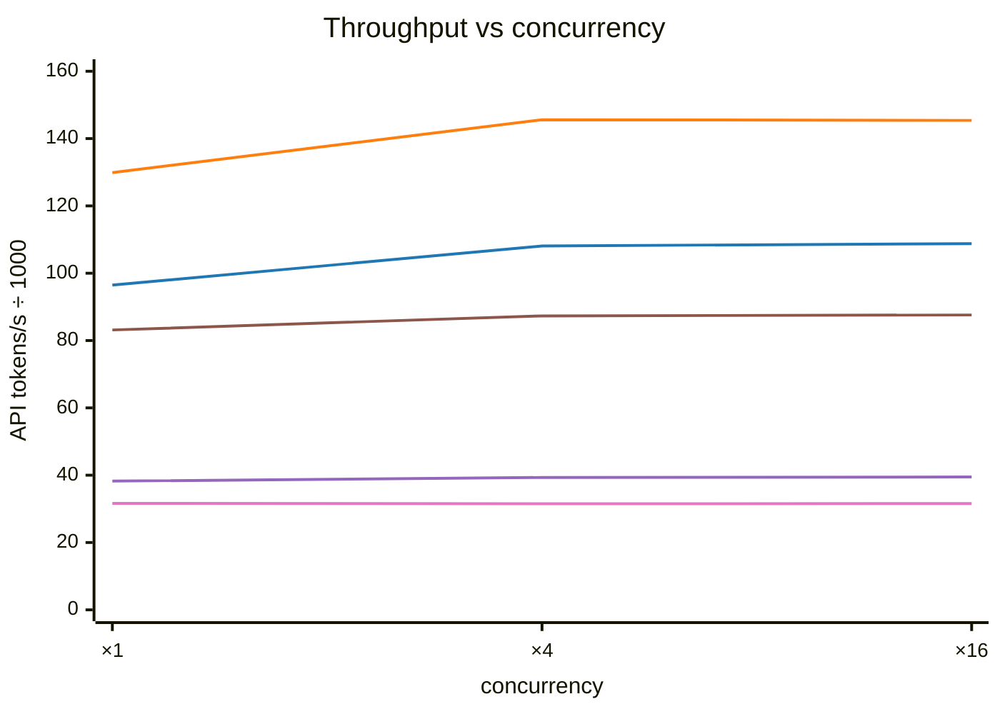
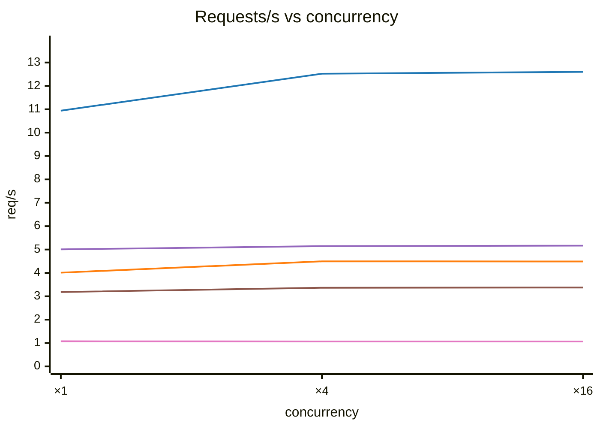
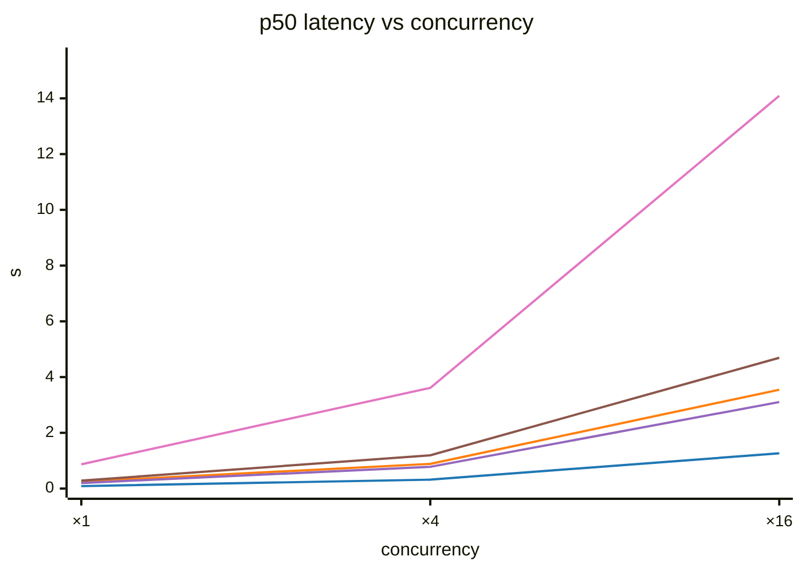

## speed — 2026-11-23 01:11 UTC

**PASS** · 441 s · 2037 requests · 0 (0.0%) errors · 0 rate-limited · 32,219,828 tokens billed

Closed loop, 25 s per cell, 5 request classes × concurrency [1, 4, 16]. 2037 requests, 32,219,828 tokens billed.

|  | requests | errors | 429s | p50 s | p90 s | p99 s | max s | req/s | API tok/s | MRR |
|---|---|---|---|---|---|---|---|---|---|---|
| short20 ×1 | 274 | 0 (0.0%) | 0 | 0.087 | 0.126 | 0.161 | 0.169 | 10.9 | 96,474 | 0.650 |
| short20 ×4 | 316 | 0 (0.0%) | 0 | 0.319 | 0.391 | 0.451 | 0.512 | 12.5 | 108,128 | 0.636 |
| short20 ×16 | 329 | 0 (0.0%) | 0 | 1.264 | 1.384 | 1.466 | 1.477 | 12.6 | 108,772 | 0.635 |
| many100 ×1 | 101 | 0 (0.0%) | 0 | 0.247 | 0.254 | 0.265 | 0.266 | 4.010 | 129,865 | 0.980 |
| many100 ×4 | 116 | 0 (0.0%) | 0 | 0.886 | 0.896 | 0.943 | 0.973 | 4.495 | 145,607 | 0.983 |
| many100 ×16 | 128 | 0 (0.0%) | 0 | 3.546 | 3.558 | 3.668 | 3.921 | 4.488 | 145,350 | 0.984 |
| long8k ×1 | 126 | 0 (0.0%) | 0 | 0.199 | 0.201 | 0.206 | 0.213 | 5.006 | 38,244 | 1.000 |
| long8k ×4 | 132 | 0 (0.0%) | 0 | 0.780 | 0.789 | 0.791 | 0.798 | 5.146 | 39,319 | 1.000 |
| long8k ×16 | 145 | 0 (0.0%) | 0 | 3.103 | 3.110 | 3.118 | 3.132 | 5.166 | 39,469 | 1.000 |
| pack32k ×1 | 80 | 0 (0.0%) | 0 | 0.284 | 0.469 | 0.550 | 0.574 | 3.182 | 83,148 | 1.000 |
| pack32k ×4 | 88 | 0 (0.0%) | 0 | 1.194 | 1.365 | 1.474 | 1.475 | 3.366 | 87,327 | 1.000 |
| pack32k ×16 | 101 | 0 (0.0%) | 0 | 4.692 | 4.993 | 5.161 | 5.176 | 3.375 | 87,598 | 1.000 |
| long32k ×1 | 27 | 0 (0.0%) | 0 | 0.869 | 1.285 | 1.292 | 1.293 | 1.074 | 31,627 | 1.000 |
| long32k ×4 | 31 | 0 (0.0%) | 0 | 3.611 | 4.236 | 4.339 | 4.340 | 1.068 | 31,510 | 1.000 |
| long32k ×16 | 43 | 0 (0.0%) | 0 | 14.1 | 15.9 | 16.1 | 16.1 | 1.064 | 31,593 | 0.988 |

*Throughput vs concurrency: short20, many100, long8k, pack32k, long32k*

*Requests/s vs concurrency: short20, many100, long8k, pack32k, long32k*

*p50 latency vs concurrency: short20, many100, long8k, pack32k, long32k*
