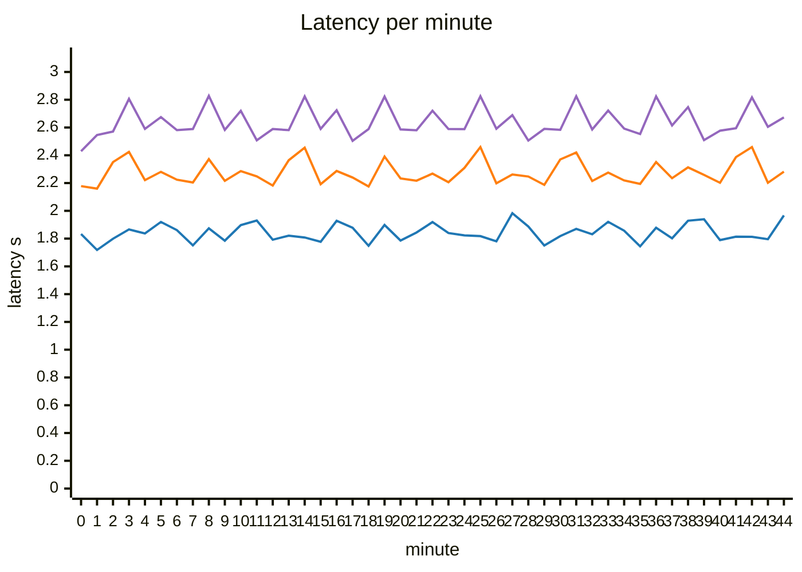
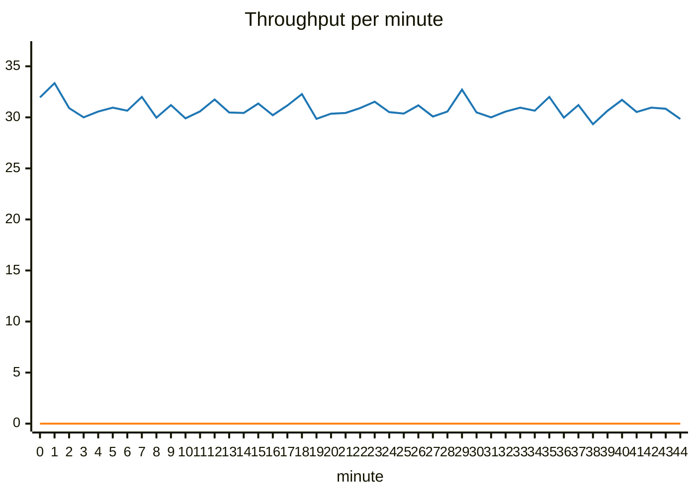

## hammer32k — 2026-11-23 09:12 UTC

**PASS** · 2701 s · 2816 requests · 0 (0.0%) errors · 0 rate-limited · 83,270,404 tokens billed

45 min closed loop with 2 concurrent ~32K-token requests (350 distinct). 2816 requests, 83,270,404 tokens billed.

|  | requests | errors | 429s | p50 s | p90 s | p99 s | max s | req/s | API tok/s | MRR |
|---|---|---|---|---|---|---|---|---|---|---|
| all | 2,816 | 0 (0.0%) | 0 | 1.837 | 2.262 | 2.602 | 2.828 | 1.043 | 30,841 | 0.980 |
| min 0–5 | 319 | 0 (0.0%) | 0 | 1.799 | 2.227 | 2.588 | 2.806 | 1.063 | 31,357 | 0.981 |
| min 5–10 | 313 | 0 (0.0%) | 0 | 1.840 | 2.263 | 2.593 | 2.828 | 1.043 | 30,953 | 0.980 |
| min 10–15 | 311 | 0 (0.0%) | 0 | 1.845 | 2.275 | 2.588 | 2.824 | 1.037 | 30,630 | 0.976 |
| min 15–20 | 314 | 0 (0.0%) | 0 | 1.843 | 2.256 | 2.590 | 2.823 | 1.047 | 30,970 | 0.977 |
| min 20–25 | 312 | 0 (0.0%) | 0 | 1.840 | 2.250 | 2.585 | 2.721 | 1.040 | 30,746 | 0.981 |
| min 25–30 | 314 | 0 (0.0%) | 0 | 1.835 | 2.247 | 2.591 | 2.825 | 1.047 | 30,981 | 0.976 |
| min 30–35 | 310 | 0 (0.0%) | 0 | 1.853 | 2.276 | 2.591 | 2.825 | 1.033 | 30,531 | 0.981 |
| min 35–40 | 311 | 0 (0.0%) | 0 | 1.851 | 2.292 | 2.614 | 2.824 | 1.037 | 30,627 | 0.983 |
| min 40–45 | 312 | 0 (0.0%) | 0 | 1.833 | 2.272 | 2.606 | 2.817 | 1.040 | 30,773 | 0.979 |

*Latency per minute: p50, p90, max*

*Throughput per minute: API tokens/s ÷ 1000, errors*
