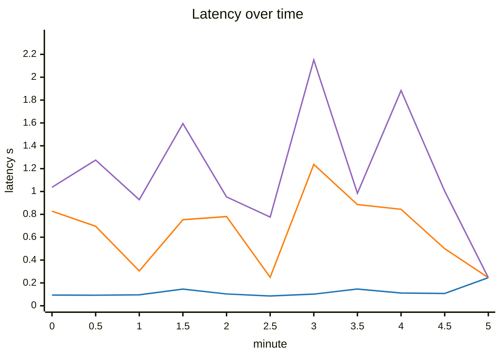
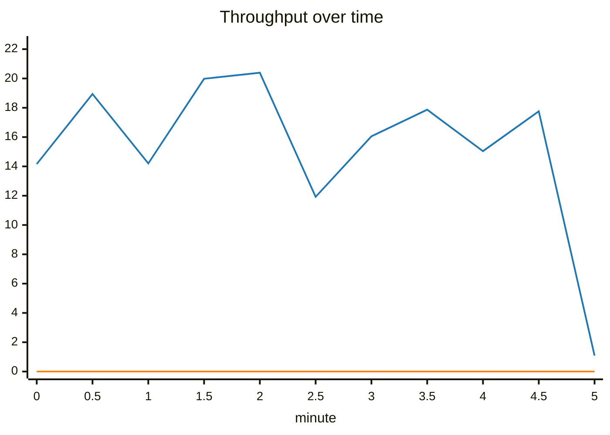

## normal — 2026-11-23 09:07 UTC

**PASS** · 301 s · 437 requests · 0 (0.0%) errors · 0 rate-limited · 5,021,503 tokens billed

5 min of Poisson traffic at 1.5 req/s; mix short20 60%, many100 10%, mid1k 10%, mid4k 10%, long8k 5%, long32k 5%. Billed 5,021,503 tokens.

|  | requests | errors | 429s | p50 s | p90 s | p99 s | max s | req/s | API tok/s | MRR |
|---|---|---|---|---|---|---|---|---|---|---|
| all | 437 | 0 (0.0%) | 0 | 0.104 | 0.831 | 1.590 | 2.151 | 1.457 | 16,738 | 0.794 |
| short20 | 241 | 0 (0.0%) | 0 | 0.093 | 0.399 | 1.455 | 1.666 | 0.803 | 6,867 | 0.637 |
| many100 | 48 | 0 (0.0%) | 0 | 0.246 | 0.554 | 1.276 | 1.336 | 0.160 | 5,191 | 0.958 |
| mid1k | 42 | 0 (0.0%) | 0 | 0.025 | 0.277 | 1.257 | 1.652 | 0.140 | 140 | 1.000 |
| mid4k | 43 | 0 (0.0%) | 0 | 0.084 | 0.223 | 0.450 | 0.554 | 0.143 | 545 | 1.000 |
| long8k | 31 | 0 (0.0%) | 0 | 0.196 | 0.962 | 1.460 | 1.582 | 0.103 | 789 | 1.000 |
| long32k | 32 | 0 (0.0%) | 0 | 0.894 | 1.289 | 2.068 | 2.151 | 0.107 | 3,206 | 0.984 |

*Latency over time: p50, p90, max*

*Throughput over time: API tokens/s ÷ 1000, errors*
