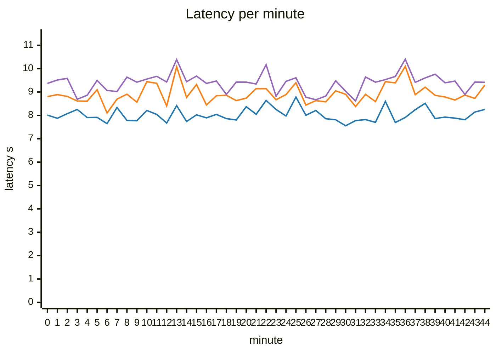
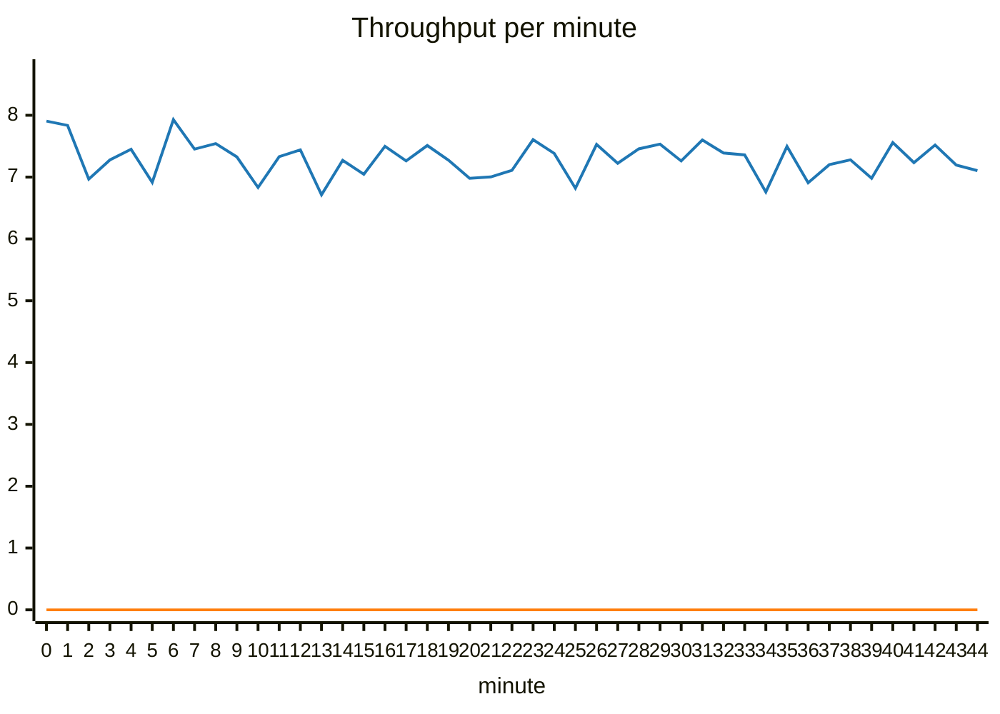

## hammer32k — 2026-11-23 09:22 UTC

**PASS** · 2708 s · 667 requests · 0 (0.0%) errors · 0 rate-limited · 19,696,712 tokens billed

45 min closed loop with 2 concurrent ~32K-token requests (350 distinct). 667 requests, 19,696,712 tokens billed.

|  | requests | errors | 429s | p50 s | p90 s | p99 s | max s | req/s | API tok/s | MRR |
|---|---|---|---|---|---|---|---|---|---|---|
| all | 667 | 0 (0.0%) | 0 | 7.980 | 8.971 | 9.676 | 10.4 | 0.247 | 7,295 | 0.997 |
| min 0–5 | 76 | 0 (0.0%) | 0 | 8.014 | 8.825 | 9.531 | 9.583 | 0.253 | 7,488 | 0.993 |
| min 5–10 | 75 | 0 (0.0%) | 0 | 7.788 | 8.803 | 9.534 | 9.639 | 0.250 | 7,433 | 1.000 |
| min 10–15 | 73 | 0 (0.0%) | 0 | 8.022 | 9.425 | 10.4 | 10.4 | 0.243 | 7,118 | 0.991 |
| min 15–20 | 74 | 0 (0.0%) | 0 | 7.903 | 8.867 | 9.574 | 9.684 | 0.247 | 7,319 | 1.000 |
| min 20–25 | 73 | 0 (0.0%) | 0 | 8.243 | 9.001 | 9.658 | 10.2 | 0.243 | 7,217 | 1.000 |
| min 25–30 | 74 | 0 (0.0%) | 0 | 8.030 | 8.846 | 9.589 | 9.609 | 0.247 | 7,312 | 1.000 |
| min 30–35 | 74 | 0 (0.0%) | 0 | 7.849 | 9.010 | 9.562 | 9.644 | 0.247 | 7,274 | 1.000 |
| min 35–40 | 73 | 0 (0.0%) | 0 | 7.952 | 9.411 | 10.4 | 10.4 | 0.243 | 7,173 | 0.986 |
| min 40–45 | 75 | 0 (0.0%) | 0 | 7.916 | 8.893 | 9.439 | 9.469 | 0.250 | 7,322 | 1.000 |

*Latency per minute: p50, p90, max*

*Throughput per minute: API tokens/s ÷ 1000, errors*
