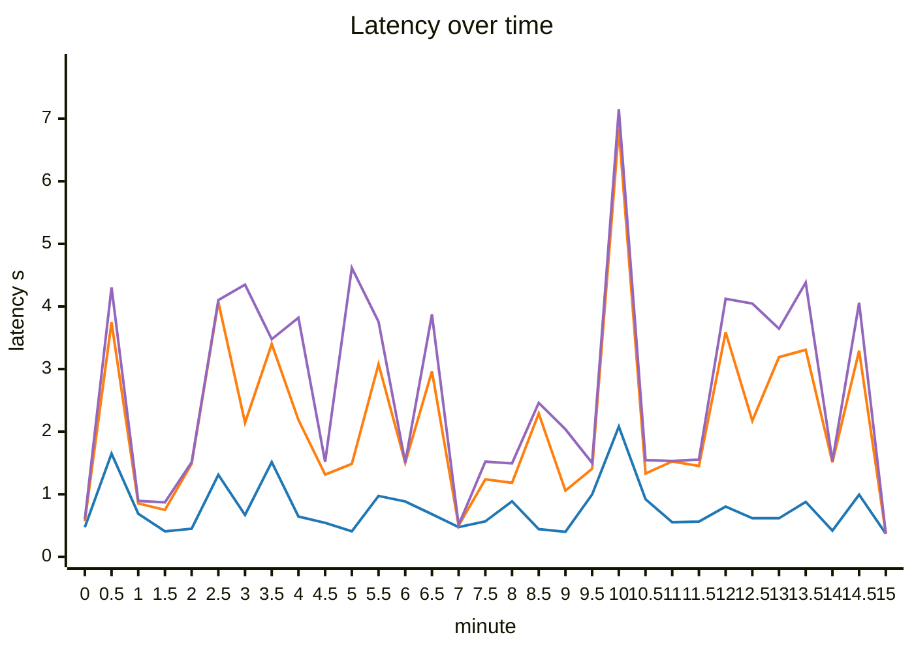
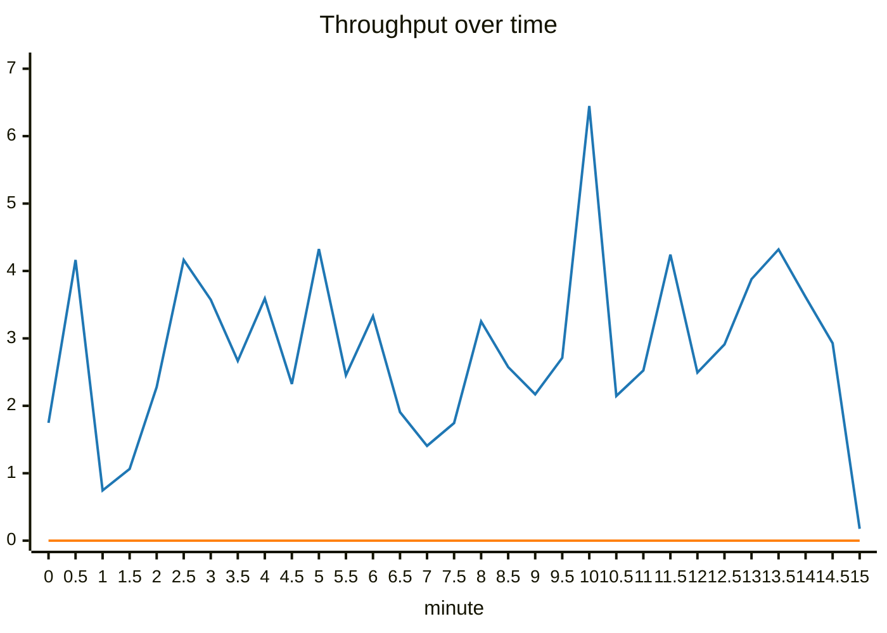

## normal — 2026-11-23 09:07 UTC

**PASS** · 917 s · 216 requests · 0 (0.0%) errors · 0 rate-limited · 2,635,982 tokens billed

15 min of Poisson traffic at 0.25 req/s; mix short20 60%, many100 10%, mid1k 10%, mid4k 10%, long8k 5%, long32k 5%. Billed 2,635,982 tokens.

|  | requests | errors | 429s | p50 s | p90 s | p99 s | max s | req/s | API tok/s | MRR |
|---|---|---|---|---|---|---|---|---|---|---|
| all | 216 | 0 (0.0%) | 0 | 0.603 | 3.369 | 6.130 | 7.151 | 0.240 | 2,929 | 0.804 |
| short20 | 119 | 0 (0.0%) | 0 | 0.508 | 1.528 | 4.336 | 6.397 | 0.132 | 1,158 | 0.657 |
| many100 | 26 | 0 (0.0%) | 0 | 1.516 | 1.984 | 2.228 | 2.231 | 0.029 | 937 | 0.942 |
| mid1k | 16 | 0 (0.0%) | 0 | 0.093 | 0.588 | 2.511 | 2.801 | 0.018 | 17.9 | 1.000 |
| mid4k | 22 | 0 (0.0%) | 0 | 0.418 | 1.103 | 1.801 | 1.916 | 0.024 | 93.0 | 1.000 |
| long8k | 15 | 0 (0.0%) | 0 | 0.897 | 2.441 | 6.267 | 6.886 | 0.017 | 127 | 1.000 |
| long32k | 18 | 0 (0.0%) | 0 | 3.846 | 4.428 | 6.720 | 7.151 | 0.020 | 595 | 1.000 |

*Latency over time: p50, p90, max*

*Throughput over time: API tokens/s ÷ 1000, errors*
