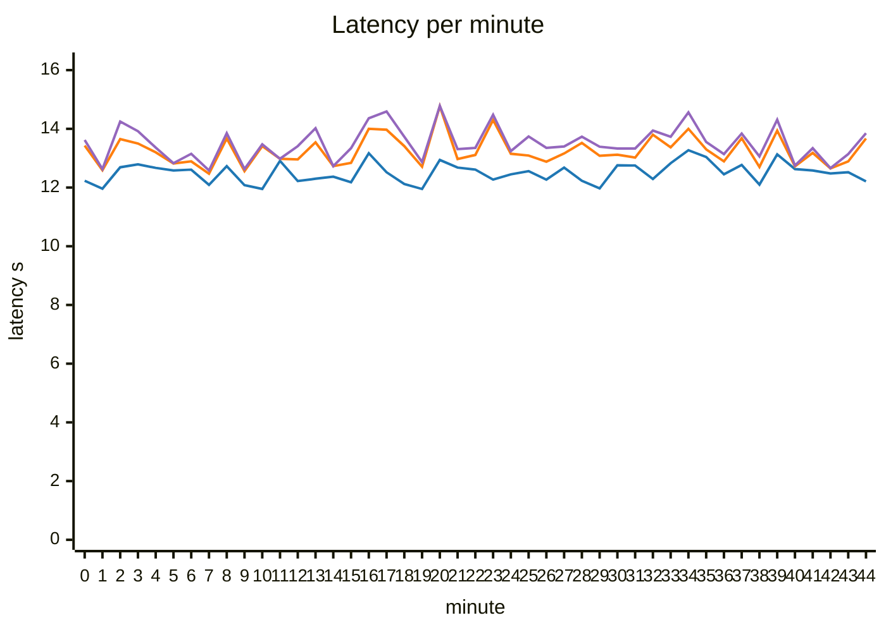
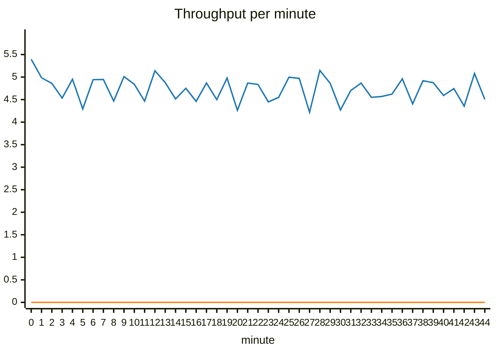

## hammer32k — 2026-11-23 09:22 UTC

**PASS** · 2707 s · 432 requests · 0 (0.0%) errors · 0 rate-limited · 12,777,952 tokens billed

45 min closed loop with 2 concurrent ~32K-token requests (350 distinct). 432 requests, 12,777,952 tokens billed.

|  | requests | errors | 429s | p50 s | p90 s | p99 s | max s | req/s | API tok/s | MRR |
|---|---|---|---|---|---|---|---|---|---|---|
| all | 432 | 0 (0.0%) | 0 | 12.5 | 13.4 | 14.4 | 14.8 | 0.160 | 4,733 | 0.997 |
| min 0–5 | 50 | 0 (0.0%) | 0 | 12.5 | 13.4 | 14.1 | 14.2 | 0.167 | 4,945 | 1.000 |
| min 5–10 | 48 | 0 (0.0%) | 0 | 12.4 | 12.9 | 13.7 | 13.9 | 0.160 | 4,732 | 1.000 |
| min 10–15 | 48 | 0 (0.0%) | 0 | 12.3 | 13.4 | 13.8 | 14.0 | 0.160 | 4,768 | 0.979 |
| min 15–20 | 48 | 0 (0.0%) | 0 | 12.3 | 13.5 | 14.5 | 14.6 | 0.160 | 4,712 | 1.000 |
| min 20–25 | 47 | 0 (0.0%) | 0 | 12.6 | 13.4 | 14.8 | 14.8 | 0.157 | 4,593 | 0.989 |
| min 25–30 | 49 | 0 (0.0%) | 0 | 12.4 | 13.4 | 13.7 | 13.7 | 0.163 | 4,839 | 1.000 |
| min 30–35 | 47 | 0 (0.0%) | 0 | 12.8 | 13.7 | 14.3 | 14.6 | 0.157 | 4,592 | 1.000 |
| min 35–40 | 48 | 0 (0.0%) | 0 | 12.6 | 13.6 | 14.1 | 14.3 | 0.160 | 4,757 | 1.000 |
| min 40–45 | 47 | 0 (0.0%) | 0 | 12.5 | 13.1 | 13.7 | 13.8 | 0.157 | 4,655 | 1.000 |

*Latency per minute: p50, p90, max*

*Throughput per minute: API tokens/s ÷ 1000, errors*
