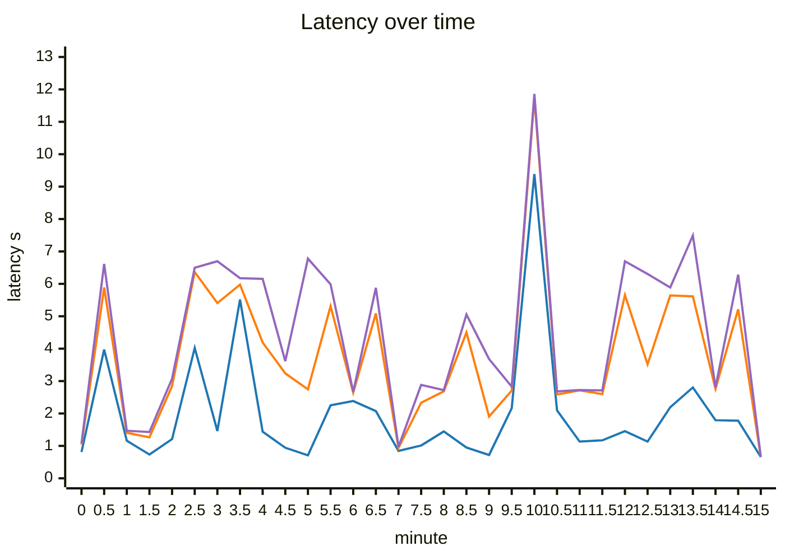
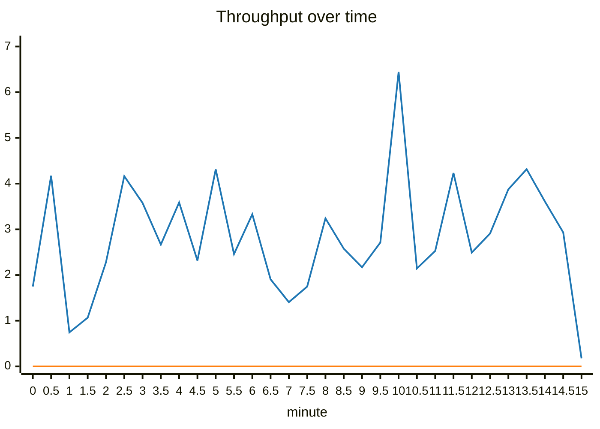

## normal — 2026-11-23 09:07 UTC

**PASS** · 918 s · 216 requests · 0 (0.0%) errors · 0 rate-limited · 2,635,188 tokens billed

15 min of Poisson traffic at 0.25 req/s; mix short20 60%, many100 10%, mid1k 10%, mid4k 10%, long8k 5%, long32k 5%. Billed 2,635,188 tokens.

|  | requests | errors | 429s | p50 s | p90 s | p99 s | max s | req/s | API tok/s | MRR |
|---|---|---|---|---|---|---|---|---|---|---|
| all | 216 | 0 (0.0%) | 0 | 1.430 | 5.882 | 11.4 | 11.9 | 0.240 | 2,928 | 0.835 |
| short20 | 119 | 0 (0.0%) | 0 | 0.971 | 4.778 | 8.856 | 11.8 | 0.132 | 1,158 | 0.709 |
| many100 | 26 | 0 (0.0%) | 0 | 2.721 | 4.889 | 10.6 | 10.9 | 0.029 | 936 | 0.962 |
| mid1k | 16 | 0 (0.0%) | 0 | 0.171 | 2.317 | 4.947 | 5.373 | 0.018 | 17.9 | 1.000 |
| mid4k | 22 | 0 (0.0%) | 0 | 0.680 | 4.683 | 9.385 | 10.6 | 0.024 | 93.0 | 1.000 |
| long8k | 15 | 0 (0.0%) | 0 | 1.471 | 5.212 | 10.9 | 11.9 | 0.017 | 127 | 1.000 |
| long32k | 18 | 0 (0.0%) | 0 | 6.071 | 6.721 | 10.7 | 11.5 | 0.020 | 595 | 1.000 |

*Latency over time: p50, p90, max*

*Throughput over time: API tokens/s ÷ 1000, errors*
